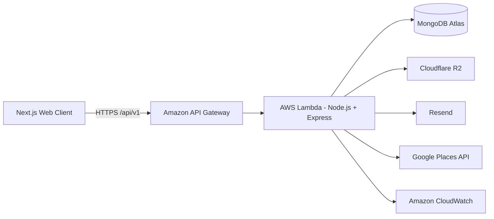
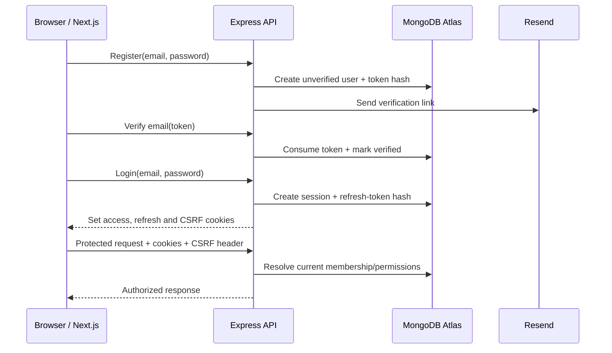
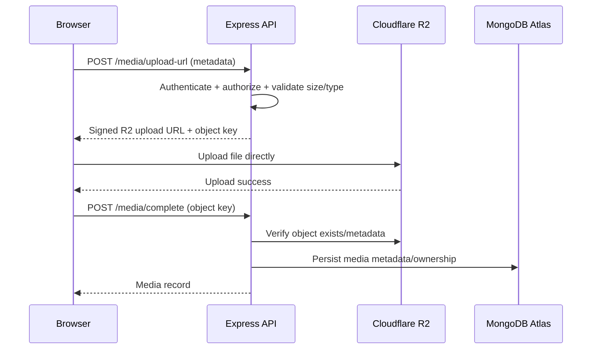

# Make My Marriage

## API Design Document

**Version 1.0 - V1 Implementation Contract**

| **Decision**   | **Finalized Choice**                                      |
|----------------|-----------------------------------------------------------|
| API style      | REST over HTTPS                                           |
| Base path      | /api/v1                                                   |
| Backend        | Node.js + Express.js on AWS Lambda                        |
| Validation     | Zod on every public request boundary                      |
| Authentication | JWT access token + opaque refresh token in secure cookies |
| Authorization  | Wedding-scoped RBAC + financeAccess                       |
| Database       | MongoDB Atlas + Mongoose                                  |
| Media          | Cloudflare R2 direct uploads                              |
| Email          | Resend                                                    |
| Version status | Approved baseline for implementation                      |

*Purpose: define the HTTP contract between the Next.js client and the Make My Marriage backend, including security, behavior, errors, permissions and evolution rules.*

> Diagrams in this Markdown version use Mermaid and render in GitHub, GitLab and compatible Markdown viewers.

# Contents

> 1\. Purpose and Scope
>
> 2\. API Design Goals
>
> 3\. System Context
>
> 4\. Global API Conventions
>
> 5\. Authentication and Session Contract
>
> 6\. Authorization and Tenant Isolation
>
> 7\. Standard Response and Error Model
>
> 8\. Query, Pagination, Sorting and Search
>
> 9\. Concurrency and Idempotency
>
> 10\. V1 Endpoint Catalog
>
> 11\. Key Request / Response Contracts
>
> 12\. Critical API Flows
>
> 13\. Delete, Restore and Relationship Rules
>
> 14\. Rate Limiting and Abuse Protection
>
> 15\. Observability and Auditability
>
> 16\. API Documentation and Testing
>
> 17\. Future Version Compatibility
>
> 18\. Deployment and Gateway Rules
>
> 19\. Architecture Decisions
>
> 20\. Recommended Implementation Order

# 1. Purpose and Scope

This document is the implementation-level API contract for Make My Marriage. It converts the approved product, system architecture and database decisions into a consistent REST interface for the web client. V1 endpoints are implementation targets; V2–V5 endpoints are compatibility plans and may be refined when those versions are designed.

- Covers public HTTP APIs exposed through Amazon API Gateway to the Next.js application.

- Defines authentication cookies, authorization checks, validation, response envelopes, errors, pagination, concurrency, idempotency and soft-delete behavior.

- Defines V1 endpoint inventory for auth, user profile, weddings, members, invitations, events, tasks, checklist, dashboard, activity and media.

- Keeps guests outside the internal dashboard. Guest-facing APIs are introduced later through the public wedding website and RSVP flows.

# 2. API Design Goals

| **Goal**            | **Design Rule**                                                                                                   |
|---------------------|-------------------------------------------------------------------------------------------------------------------|
| Simple to build     | Conventional REST; no GraphQL, gRPC or microservice gateway complexity in V1.                                     |
| Secure by default   | Every protected request authenticates the session and verifies wedding membership server-side.                    |
| Predictable         | Plural resource names, consistent envelopes, status codes, validation errors and pagination.                      |
| Safe collaboration  | Optimistic concurrency prevents silent overwrites; critical POSTs support idempotency.                            |
| Low cost            | Serverless-friendly endpoints; direct R2 uploads keep binary traffic away from Lambda.                            |
| Future-ready        | Wedding ID is explicit in resource paths so multi-wedding support can be added later without redesigning the API. |
| Backward-compatible | Versioned base path; non-breaking additions preferred within v1.                                                  |

# 3. System Context

| The API is the only trusted business-logic boundary. Frontend validation improves UX but never replaces backend Zod validation, authorization or database constraints. |
|------------------------------------------------------------------------------------------------------------------------------------------------------------------------|

# 4. Global API Conventions

| **Area**        | **Standard**                                                                 |
|-----------------|------------------------------------------------------------------------------|
| Base URL        | https://\<api-host\>/api/v1                                                  |
| Transport       | HTTPS only outside local development                                         |
| Payload         | application/json; UTF-8                                                      |
| Resource naming | Plural nouns; lower-case path segments; IDs use MongoDB ObjectId strings     |
| Dates/times     | ISO-8601 strings in UTC; UI converts to wedding/user locale                  |
| Money           | Integer minor units (paise) in APIs and DB; never floating-point currency    |
| Booleans        | true / false only                                                            |
| Nullability     | Use null only when absence is meaningful; omit unknown optional input fields |
| Request IDs     | Every response includes x-request-id; client may send x-correlation-id       |
| Versioning      | URI versioning with /api/v1                                                  |
| Mutation format | PATCH for partial update; POST for actions; DELETE for soft delete           |
| Unknown fields  | Rejected on sensitive write schemas where practical using strict Zod objects |

## 4.1 Resource path pattern

/api/v1/weddings/{weddingId}/events  
/api/v1/weddings/{weddingId}/events/{eventId}  
/api/v1/weddings/{weddingId}/tasks/{taskId}

Although V1 allows a user to belong to only one wedding, the wedding identifier remains explicit in scoped URLs. This makes authorization boundaries visible and avoids breaking the API if multi-wedding support is added later.

# 5. Authentication and Session Contract

V1 uses first-party email/password authentication. The backend issues a short-lived JWT access token and a rotating opaque refresh token. Both are delivered through secure HTTP-only cookies; the refresh token is stored only as a hash in MongoDB.

| **Item**           | **Recommended V1 Behavior**                                                                           |
|--------------------|-------------------------------------------------------------------------------------------------------|
| Access token       | JWT, approximately 15 minutes; contains userId and sessionId, not mutable role permissions.           |
| Refresh token      | Cryptographically random opaque token; ~30-day persistence; rotate on every refresh; store hash only. |
| Access cookie      | HttpOnly, Secure, SameSite=None where staging/prod hosts are cross-site; Path=/api/v1.                |
| Refresh cookie     | HttpOnly, Secure, SameSite=None; narrow Path=/api/v1/auth.                                            |
| CSRF               | Double-submit CSRF token + X-CSRF-Token for unsafe methods; also validate Origin/Referer.             |
| CORS               | Explicit allow-list for known frontend origins; credentials=true; never wildcard with credentials.    |
| Logout             | Revokes current refresh session and clears auth cookies.                                              |
| Email verification | Required before dashboard access.                                                                     |
| Password reset     | Single-use expiring token; ~30 minutes; token hash stored server-side.                                |
| Member invitation  | Single-use token, tied to invited email, expires after 7 days.                                        |

## 5.1 Auth endpoints

| **Method** | **Path**                  | **Purpose**                                               | **Access**     |
|------------|---------------------------|-----------------------------------------------------------|----------------|
| POST       | /auth/register            | Create unverified account and send verification email     | Public         |
| POST       | /auth/verify-email        | Verify email using one-time token                         | Public         |
| POST       | /auth/resend-verification | Issue a new verification email with throttling            | Public         |
| POST       | /auth/login               | Authenticate and create session cookies                   | Public         |
| POST       | /auth/refresh             | Rotate refresh token and issue new access token           | Refresh cookie |
| POST       | /auth/logout              | Revoke current device session                             | Authenticated  |
| GET        | /auth/session             | Return current user/session/wedding context               | Authenticated  |
| POST       | /auth/forgot-password     | Send reset link without disclosing whether account exists | Public         |
| POST       | /auth/reset-password      | Set new password using valid reset token                  | Public         |

# 6. Authorization and Tenant Isolation

Authentication proves identity; authorization is always resolved using current database state. Role changes therefore take effect immediately even if an older access JWT still exists.

| **Capability**                      | **Admin** | **Family Member**          | **Viewer** |
|-------------------------------------|-----------|----------------------------|------------|
| Read normal wedding/event/task data | Yes       | Yes                        | Yes        |
| Create/update events and tasks      | Yes       | Yes                        | No         |
| Manage members/roles                | Yes       | No                         | No         |
| Manage wedding settings             | Yes       | No                         | No         |
| Read/manage finance                 | Yes       | Only if financeAccess=true | No         |
| Delete/restore important records    | Yes       | Limited by resource policy | No         |

## 6.1 Required server-side checks

- Validate weddingId format before querying.

- Load active WeddingMember membership for (userId, weddingId).

- Reject soft-deleted wedding/member contexts except dedicated restore flows.

- Check role/financeAccess for the requested action.

- Query child resources with both \_id and weddingId to prevent cross-wedding ID tampering.

- Never trust role, weddingId or financeAccess supplied by the client body.

# 7. Standard Response and Error Model

## 7.1 Success envelope

{  
"success": true,  
"data": { ... },  
"meta": { ... optional pagination/summary ... }  
}

## 7.2 Error envelope

{  
"success": false,  
"error": {  
"code": "EVENT_VERSION_CONFLICT",  
"message": "This event was changed by another member.",  
"details": \[{ "field": "startAt", "issue": "..." }\]  
},  
"requestId": "..."  
}

| **HTTP** | **Use**                                                  |
|----------|----------------------------------------------------------|
| 200      | Successful read/update/action                            |
| 201      | Resource created                                         |
| 202      | Accepted for async work or non-disclosing email action   |
| 204      | Successful action with no body when appropriate          |
| 400      | Malformed request / invalid action                       |
| 401      | Not authenticated / expired access with no valid refresh |
| 403      | Authenticated but forbidden                              |
| 404      | Resource not found in caller wedding context             |
| 409      | Conflict: duplicate, state conflict, version conflict    |
| 410      | Expired/consumed invitation or recovery window gone      |
| 422      | Semantically invalid validated input                     |
| 429      | Rate limit exceeded                                      |
| 500      | Unexpected server error                                  |
| 503      | Dependency unavailable / temporary service failure       |

## 7.3 Stable error codes

| **Category** | **Examples**                                                           |
|--------------|------------------------------------------------------------------------|
| Auth         | INVALID_CREDENTIALS, EMAIL_NOT_VERIFIED, SESSION_EXPIRED, CSRF_INVALID |
| Invitation   | INVITATION_EXPIRED, INVITATION_USED, INVITATION_EMAIL_MISMATCH         |
| Wedding      | WEDDING_ALREADY_EXISTS, WEDDING_DELETED, LAST_ADMIN_PROTECTED          |
| Validation   | VALIDATION_ERROR, EVENT_TIME_INVALID, TASK_DUE_DATE_INVALID            |
| Concurrency  | VERSION_CONFLICT                                                       |
| Permissions  | FORBIDDEN, FINANCE_ACCESS_REQUIRED                                     |
| Media        | UPLOAD_TYPE_NOT_ALLOWED, UPLOAD_TOO_LARGE, MEDIA_NOT_FOUND             |

# 8. Query, Pagination, Sorting and Search

| **Concern**   | **Convention**                                                                               |
|---------------|----------------------------------------------------------------------------------------------|
| Pagination    | ?page=1&limit=20; default 20; maximum 100                                                    |
| Sorting       | ?sort=dueAt&order=asc; allow-list sortable fields                                            |
| Search        | ?q=keyword; sanitize input and use indexed/searchable fields where practical                 |
| Filtering     | Explicit query keys such as status, priority, assigneeId, eventId, from, to                  |
| Soft delete   | Normal list/read excludes deletedAt != null; admin recovery endpoints opt in to deleted data |
| Empty results | 200 with data: \[\] and pagination meta; never 404 for empty collections                     |

GET /api/v1/weddings/{weddingId}/tasks?page=1&limit=20&status=IN_PROGRESS&priority=HIGH&assigneeId=...&sort=dueAt&order=asc

# 9. Concurrency and Idempotency

## 9.1 Optimistic concurrency

Mutable resources return an ETag derived from the record version. PATCH/DELETE requests for collaborative resources send If-Match. A stale version returns 409 VERSION_CONFLICT instead of silently overwriting another member’s update.

GET /events/123 -> ETag: "7"  
PATCH /events/123  
If-Match: "7"  
  
If current version is 8 -> 409 VERSION_CONFLICT

## 9.2 Idempotency

Critical create/action endpoints accept an Idempotency-Key header. The server stores a short-lived key/result record so double-clicks, retries or Lambda/network retries do not create duplicates.

| **Recommended idempotent actions** | **Reason**                           |
|------------------------------------|--------------------------------------|
| POST /weddings                     | Prevent duplicate wedding creation   |
| POST member invitation             | Prevent duplicate active invitations |
| POST /checklists/generate          | Prevent duplicate generated tasks    |
| POST /media/complete               | Prevent duplicate media metadata     |
| Future payment/expense actions     | Avoid duplicate financial records    |

# 10. V1 Endpoint Catalog

All protected wedding-scoped endpoints require active membership in {weddingId}. “Family+” means Admin or Family Member unless otherwise stated.

## 10.1 User profile

| **Method** | **Path**                | **Purpose**                               | **Access**    |
|------------|-------------------------|-------------------------------------------|---------------|
| GET        | /users/me               | Current profile                           | Authenticated |
| PATCH      | /users/me               | Update name/basic profile                 | Authenticated |
| DELETE     | /users/me/profile-image | Detach profile photo; schedule R2 cleanup | Authenticated |

## 10.2 Wedding

| **Method** | **Path**                          | **Purpose**                                      | **Access**                    |
|------------|-----------------------------------|--------------------------------------------------|-------------------------------|
| POST       | /weddings                         | Create the user’s wedding; creator becomes Admin | Verified user                 |
| GET        | /weddings/{weddingId}             | Read wedding                                     | Member                        |
| PATCH      | /weddings/{weddingId}             | Update wedding settings                          | Admin                         |
| DELETE     | /weddings/{weddingId}             | Soft delete wedding and start 7-day recovery     | Admin                         |
| POST       | /weddings/{weddingId}/restore     | Restore during recovery window                   | Admin / creator recovery flow |
| DELETE     | /weddings/{weddingId}/cover-image | Detach cover image and queue cleanup             | Admin                         |

## 10.3 Members and invitations

| **Method** | **Path**                                      | **Purpose**                                   | **Access**    |
|------------|-----------------------------------------------|-----------------------------------------------|---------------|
| GET        | /weddings/{weddingId}/members                 | List members                                  | Member        |
| PATCH      | /weddings/{weddingId}/members/{memberId}      | Change role / financeAccess                   | Admin         |
| DELETE     | /weddings/{weddingId}/members/{memberId}      | Remove member; protect last Admin             | Admin         |
| GET        | /weddings/{weddingId}/invitations             | List active/history invitations               | Admin         |
| POST       | /weddings/{weddingId}/invitations             | Create invite + send via Resend               | Admin         |
| POST       | /weddings/{weddingId}/invitations/{id}/resend | Rotate/resend invite token                    | Admin         |
| DELETE     | /weddings/{weddingId}/invitations/{id}        | Revoke active invitation                      | Admin         |
| GET        | /member-invitations/{token}                   | Preview invitation metadata                   | Public token  |
| POST       | /member-invitations/{token}/accept            | Accept after login/register; email must match | Authenticated |

## 10.4 Events and activities

| **Method** | **Path**                                                       | **Purpose**                      | **Access**     |
|------------|----------------------------------------------------------------|----------------------------------|----------------|
| GET        | /weddings/{weddingId}/events                                   | List/filter events               | Member         |
| POST       | /weddings/{weddingId}/events                                   | Create event                     | Family+        |
| GET        | /weddings/{weddingId}/events/{eventId}                         | Event details                    | Member         |
| PATCH      | /weddings/{weddingId}/events/{eventId}                         | Partial update with If-Match     | Family+        |
| DELETE     | /weddings/{weddingId}/events/{eventId}                         | Soft delete; no cascade deletion | Admin / policy |
| POST       | /weddings/{weddingId}/events/{eventId}/restore                 | Restore deleted event            | Admin          |
| POST       | /weddings/{weddingId}/events/{eventId}/activities              | Add lightweight activity         | Family+        |
| PATCH      | /weddings/{weddingId}/events/{eventId}/activities/{activityId} | Update activity                  | Family+        |
| DELETE     | /weddings/{weddingId}/events/{eventId}/activities/{activityId} | Remove activity                  | Family+        |

## 10.5 Tasks

| **Method** | **Path**                                     | **Purpose**                             | **Access**             |
|------------|----------------------------------------------|-----------------------------------------|------------------------|
| GET        | /weddings/{weddingId}/tasks                  | List/search/filter tasks                | Member                 |
| POST       | /weddings/{weddingId}/tasks                  | Create task; optional recurrence        | Family+                |
| GET        | /weddings/{weddingId}/tasks/{taskId}         | Task details                            | Member                 |
| PATCH      | /weddings/{weddingId}/tasks/{taskId}         | Update status, assignees, due date etc. | Family+                |
| DELETE     | /weddings/{weddingId}/tasks/{taskId}         | Soft delete task                        | Family+                |
| POST       | /weddings/{weddingId}/tasks/{taskId}/restore | Restore task                            | Admin / creator policy |
| GET        | /weddings/{weddingId}/tasks/my               | Current user’s assigned tasks           | Member                 |

## 10.6 Checklist

| **Method** | **Path**                                     | **Purpose**                                  | **Access**     |
|------------|----------------------------------------------|----------------------------------------------|----------------|
| GET        | /checklist-templates                         | List available generic templates             | Authenticated  |
| POST       | /weddings/{weddingId}/checklists/generate    | Generate normal tasks from selected template | Admin / Family |
| GET        | /weddings/{weddingId}/checklists/generations | Generation history / source metadata         | Member         |

## 10.7 Dashboard and activity

| **Method** | **Path**                        | **Purpose**                                                    | **Access** |
|------------|---------------------------------|----------------------------------------------------------------|------------|
| GET        | /weddings/{weddingId}/dashboard | Aggregated countdown, progress, tasks, events, attention items | Member     |
| GET        | /weddings/{weddingId}/activity  | Paginated audit/activity feed                                  | Member     |

## 10.8 Media

| **Method** | **Path**                               | **Purpose**                                                 | **Access**             |
|------------|----------------------------------------|-------------------------------------------------------------|------------------------|
| POST       | /weddings/{weddingId}/media/upload-url | Validate type/size and return R2 signed upload URL          | Family+ / owner policy |
| POST       | /weddings/{weddingId}/media/complete   | Confirm object and persist metadata/ownership               | Family+ / owner policy |
| GET        | /weddings/{weddingId}/media/{mediaId}  | Read metadata / authorized signed read URL if private       | Member / policy        |
| DELETE     | /weddings/{weddingId}/media/{mediaId}  | Detach/soft delete metadata; async R2 cleanup when orphaned | Owner/Admin policy     |

# 11. Key Request / Response Contracts

## 11.1 Login

POST /api/v1/auth/login  
{  
"email": "user@example.com",  
"password": "\*\*\*\*\*\*\*\*"  
}  
  
200  
{  
"success": true,  
"data": {  
"user": { "id": "...", "name": "...", "emailVerified": true },  
"weddingContext": { "weddingId": "...", "role": "ADMIN", "financeAccess": true }  
}  
}  
// response also sets access, refresh and csrf cookies

## 11.2 Create event

POST /api/v1/weddings/{weddingId}/events  
Idempotency-Key: \<uuid\>  
  
{  
"name": "Reception",  
"description": "Evening reception",  
"startAt": "2027-02-10T12:30:00Z",  
"endAt": "2027-02-10T17:30:00Z",  
"status": "PLANNED",  
"venue": {  
"name": "Example Convention Centre",  
"formattedAddress": "...",  
"googlePlaceId": "...",  
"latitude": 20.0,  
"longitude": 85.0,  
"city": "Bhubaneswar",  
"state": "Odisha"  
}  
}

## 11.3 Update task with concurrency protection

PATCH /api/v1/weddings/{weddingId}/tasks/{taskId}  
If-Match: "4"  
X-CSRF-Token: \<token\>  
  
{ "status": "COMPLETED" }  
  
200 -> ETag: "5"  
409 -> VERSION_CONFLICT if another user already changed version 4

## 11.4 Dashboard response shape

{  
"success": true,  
"data": {  
"wedding": { "name": "...", "mainDate": "...", "daysRemaining": 92 },  
"progress": { "completed": 18, "total": 42, "percent": 43 },  
"taskSummary": { "todo": 12, "inProgress": 8, "completed": 18, "overdue": 4 },  
"myTasks": \[ ... \],  
"upcomingEvents": \[ ... \],  
"attentionRequired": \[ ... \],  
"recentActivity": \[ ... \]  
}  
}

# 12. Critical API Flows

## 12.1 Registration and verification

1. Client submits registration data.

2. API validates, normalizes email, checks uniqueness and hashes password.

3. User is created as unverified; verification token hash is stored.

4. API asks Resend to send a one-time link.

5. Verification endpoint consumes token, marks email verified and invalidates token.

6. Only verified users may enter protected wedding setup/dashboard flows.

## 12.2 Member invitation

1. Admin creates invitation for an email and role.

2. API prevents duplicate active invitation and signs/generates a secure random token; only hash is stored.

3. Resend sends the invite link; UI can also copy the link.

4. Recipient logs in or registers.

5. Accept endpoint requires authenticated email to match the invited email.

6. Transaction creates WeddingMember and marks invitation consumed.

## 12.3 Media upload

| Binary file bytes should not be proxied through Lambda. The API authorizes the upload and owns metadata; the browser uploads directly to R2. |
|----------------------------------------------------------------------------------------------------------------------------------------------|

# 13. Delete, Restore and Relationship Rules

DELETE on important business resources means soft delete unless explicitly documented otherwise. Deleting a parent never blindly cascade-deletes important children or financial/audit history.

| **Deleted resource**     | **API behavior**                                                                                                                                                   |
|--------------------------|--------------------------------------------------------------------------------------------------------------------------------------------------------------------|
| Wedding                  | Mark deleted; block normal access; allow 7-day restore. After recovery window, async purge may hard-delete wedding-owned data and orphaned R2 objects.             |
| Event                    | Soft delete event. Tasks remain. Guest invitations/RSVP later become inactive/archived for that event. Vendors and expenses remain. Activity records the deletion. |
| Task                     | Soft delete task; retain history and source/checklist metadata.                                                                                                    |
| Member                   | Deactivate/remove membership; unassign/reassign tasks as policy; never delete user account.                                                                        |
| Media                    | Detach business reference; mark metadata deleted; queue physical R2 deletion only when no active reference remains.                                                |
| Temporary security token | Hard-delete/TTL after expiry or consumption where appropriate.                                                                                                     |

## 13.1 Delete-impact preview

Before destructive actions such as deleting an event, the client may request impact metadata or the DELETE response may include counts. The UI should warn the Admin when related records exist.

{  
"eventId": "...",  
"impact": {  
"tasks": 12,  
"guestInvitations": 146,  
"vendors": 3,  
"expenseAmountPaise": 12500000  
}  
}

# 14. Rate Limiting and Abuse Protection

| **Endpoint family**                   | **Suggested initial policy**                                    |
|---------------------------------------|-----------------------------------------------------------------|
| Login                                 | Strict per IP + normalized email; progressive backoff           |
| Forgot password / resend verification | Strict per IP + email; return non-disclosing responses          |
| Invitation create/resend              | Per Admin + wedding + target email                              |
| Public token endpoints                | Per IP/token fingerprint; do not leak token state unnecessarily |
| Media upload URL                      | Per user/wedding plus file size/type caps                       |
| General authenticated API             | Generous user/IP limit; protect against runaway clients         |

Exact numeric thresholds should be configuration values and tuned after observing normal usage. API Gateway throttling can provide a coarse outer limit; application-level limits protect account- or resource-specific actions.

# 15. Observability and Auditability

- Generate x-request-id for every request; propagate correlation ID through logs.

- Log route template, method, status, duration, userId/sessionId when authenticated, weddingId when scoped, and error code. Do not log passwords, raw auth tokens, invitation tokens or sensitive cookie values.

- CloudWatch captures Lambda/application logs; structured JSON logs are preferred.

- Business activity events are separate from technical logs and are stored in the Activity collection.

- Unexpected 5xx errors return a safe message and requestId; detailed stack traces remain server-side only.

# 16. API Documentation and Testing

| **Area**          | **Decision**                                                                                                           |
|-------------------|------------------------------------------------------------------------------------------------------------------------|
| Contract format   | OpenAPI 3.1 maintained alongside backend; Zod schemas should remain the validation source of truth.                    |
| Interactive docs  | Swagger/OpenAPI UI may be enabled in local/staging; disable or protect in production.                                  |
| Unit tests        | Services, validation helpers, permission policies, token utilities.                                                    |
| Integration tests | Express routes + Mongo test database using Jest/Supertest.                                                             |
| E2E               | Playwright for critical user journeys: register/verify, create wedding, invite member, event/task flows.               |
| Contract tests    | Assert response/error envelopes and permission behavior for each role.                                                 |
| Security tests    | ID tampering, CSRF, expired token, reused invite, last-admin protection, finance access, soft-deleted resource access. |

# 17. Future Version Compatibility

Future endpoints remain under /api/v1 as long as additions are backward-compatible. They are listed now to preserve naming and resource boundaries, not as immediate implementation scope.

| **Version** | **Planned resource families**                            | **Example routes**                                                                        |
|-------------|----------------------------------------------------------|-------------------------------------------------------------------------------------------|
| V2          | Guests, guest groups, event invitations, RSVP            | /weddings/{id}/guests; /weddings/{id}/guest-invitations; /public/invitations/{token}/rsvp |
| V3          | Budgets, expenses, payments, vendors, notifications      | /weddings/{id}/budget; /expenses; /vendors; /notifications                                |
| V4          | Hotels/rooms/guest accommodation assignments             | /weddings/{id}/accommodation/hotels; /rooms; /assignments                                 |
| V5          | Public wedding site, gallery, approvals, livestream link | /public/weddings/{slug}; /weddings/{id}/gallery; /media/{id}/approve                      |

## 17.1 Public wedding website rule

Guests do not receive authenticated dashboard accounts by default. The public wedding website exposes only curated wedding information. Invitation/RSVP token context determines guest-specific event visibility where needed; internal tasks, members, finance, vendors and activity remain private.

# 18. Deployment and Gateway Rules

| **Layer**          | **Rule**                                                                                                            |
|--------------------|---------------------------------------------------------------------------------------------------------------------|
| API Gateway        | HTTP API routes proxy to Lambda/Express. Configure CORS allow-list, throttling and request size limits.             |
| Lambda             | Single modular-monolith handler initially; keep DB connection outside handler for reuse between warm invocations.   |
| MongoDB Atlas      | Use pooled/reused connection; indexes support wedding-scoped list/filter queries.                                   |
| Secrets            | Use environment-specific secret storage/config; never commit credentials.                                           |
| Staging/Production | Separate environment variables, database names/credentials, R2 prefixes/buckets as practical, and frontend origins. |
| AWS SAM            | Defines Lambda/API Gateway and supporting AWS resources; deployment changes are reviewable in source control.       |

# 19. Architecture Decisions

| **ADR** | **Decision**                      | **Reason**                                                                      |
|---------|-----------------------------------|---------------------------------------------------------------------------------|
| API-001 | REST + /api/v1                    | Simple, conventional and sufficient for the product.                            |
| API-002 | Wedding-scoped URLs               | Makes tenant boundary explicit and supports future multi-wedding.               |
| API-003 | Cookie auth + CSRF                | Supports persistent first-party sessions without exposing tokens to JavaScript. |
| API-004 | Opaque rotating refresh token     | Easy revocation/device sessions and safer DB storage via hash.                  |
| API-005 | ETag/If-Match concurrency         | Prevents silent collaborative overwrite.                                        |
| API-006 | Idempotency-Key on critical POSTs | Prevents duplicates from retry/double-submit.                                   |
| API-007 | Soft delete business data         | Supports recovery, audit and relationship safety.                               |
| API-008 | Direct R2 upload                  | Reduces Lambda cost/latency and scales gallery media efficiently.               |
| API-009 | No guest dashboard API            | Keep product lighter; guest experience lives on public wedding site.            |
| API-010 | OpenAPI contract                  | Improves implementation clarity, testing and future client integrations.        |

# 20. Recommended Implementation Order

1. Build shared Express foundation: request ID, JSON parser, CORS, Helmet, cookie parser, CSRF, error middleware and Zod validation helper.

2. Implement auth/session/token models and auth endpoints; add Resend verification/reset flows.

3. Implement current-user profile and wedding creation/read/update/delete/restore.

4. Implement membership authorization middleware and Admin/Family/Viewer policy helpers.

5. Implement member invitations and role/financeAccess administration.

6. Implement events and activities with ETag/If-Match concurrency.

7. Implement tasks, assignees, recurrence generation and checklist generation with idempotency.

8. Implement dashboard aggregation and activity feed.

9. Implement generic R2 media upload/complete/delete service and connect profile/cover images.

10. Finalize OpenAPI 3.1 spec, integration/security tests, CloudWatch structured logging and AWS SAM deployment.

*API Design v1.0 is intended to be reviewed together with the System Design and Database Design documents. If the database model changes, endpoint payloads and relationship behaviors should be updated here before implementation.*
