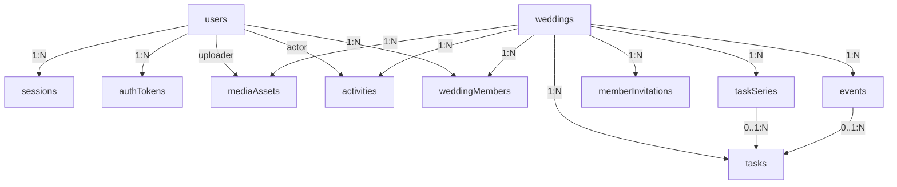
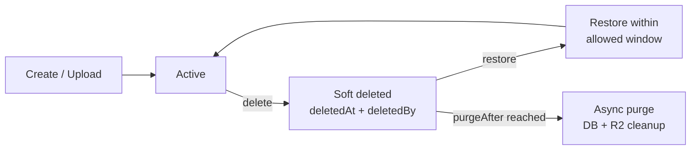
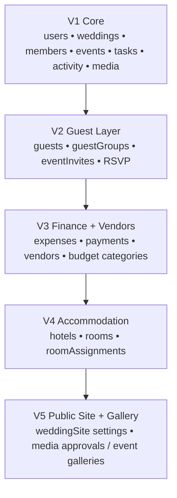

# Make My Marriage

## Database Design Document

MongoDB Atlas • Mongoose • V1 Core + Future-Compatible Extension Plan

| **Version**            | 1.0                                                |
|------------------------|----------------------------------------------------|
| **Status**             | Implementation baseline / reviewable               |
| **Database**           | MongoDB Atlas                                      |
| **Companion document** | Make My Marriage System Design & Architecture v1.0 |

*Design principle: keep V1 simple and inexpensive, but choose collection boundaries and indexes that let guest, finance, accommodation and gallery features arrive without rewriting the core model.*

# 1. Purpose and Scope

This document defines the application database design for Make My Marriage. It turns the high-level data model from the system architecture into implementable MongoDB/Mongoose schemas, constraints, indexes, lifecycle rules and query patterns.

## 1.1 Scope

- Detailed V1 persistence model: authentication, users, weddings, members, events, tasks, recurrence, activity and media metadata.

- Reference-versus-embed rules and aggregate boundaries.

- Indexes for the actual dashboard, event, task, invitation and auth query patterns.

- Soft deletion, 7-day wedding recovery, asynchronous purge and R2 cleanup.

- Optimistic concurrency, idempotency and integrity-sensitive transaction boundaries.

- Compatibility plan for V2 guests/RSVP, V3 finance/vendors, V4 accommodation and V5 public site/gallery.

## 1.2 Non-goals

- This document does not redesign the already approved product roadmap or system architecture.

- It does not introduce microservices, Redis, Kafka, relational databases or a separate analytics warehouse.

- Future-version collections are compatibility designs, not a commitment to implement them in V1.

# 2. Database Design Principles

| **Principle**                       | **Decision**                                                                                                                                                               |
|-------------------------------------|----------------------------------------------------------------------------------------------------------------------------------------------------------------------------|
| Wedding-scoped data isolation       | Every protected domain query is constrained by weddingId after membership authorization. Client-supplied IDs never imply ownership.                                        |
| Reference growing aggregates        | Users, weddings, events, tasks, members, sessions and audit entries are separate collections.                                                                              |
| Embed bounded snapshots             | Venue details and lightweight event activities are embedded because they are small and normally read with the parent event.                                                |
| No giant Wedding document           | Events, tasks, guests, expenses, vendors and photos never accumulate in an unbounded array inside weddings.                                                                |
| UTC instants + explicit local dates | Store timestamps as UTC BSON Date. Store date-only business concepts such as main wedding date and recurrence occurrence date as YYYY-MM-DD strings plus wedding timezone. |
| Recover before purge                | Important business records soft-delete first. Hard deletion and R2 object cleanup happen asynchronously after policy allows.                                               |
| Query-driven indexes                | Indexes are added for concrete access patterns, not speculative coverage.                                                                                                  |
| Secure ephemeral data               | Refresh, verification, reset and invitation tokens are never stored in plaintext; only hashes are persisted.                                                               |
| Optimistic concurrency              | Use Mongoose versioning on collaborative write-sensitive entities to reject stale updates with HTTP 409.                                                                   |
| Free-tier aware                     | Avoid DB features or data duplication that create unnecessary storage/compute costs during MVP development.                                                                |

# 3. Logical Data Model



*Figure 1. V1 collection relationships. Small bounded event substructures are embedded; growing aggregates are referenced.*

The V1 model contains eleven main collections. The wedding is the principal tenant boundary, but not every document is embedded below it. This keeps documents bounded and makes task/event/member queries efficient.

## 3.1 Collection Inventory

| **Collection**    | **Scope**    | **Purpose**                                  | **Lifecycle**             |
|-------------------|--------------|----------------------------------------------|---------------------------|
| users             | Global       | Account identity and profile                 | Long-lived                |
| sessions          | Global/user  | Per-device refresh session                   | TTL                       |
| authTokens        | Global/user  | Email verification and password reset        | TTL                       |
| weddings          | Wedding root | Wedding profile and core settings            | Soft delete + recovery    |
| weddingMembers    | Wedding      | User membership, role and finance permission | Long-lived                |
| memberInvitations | Wedding      | Family/dashboard invitation lifecycle        | TTL/terminal state        |
| events            | Wedding      | Ceremony/event schedule and venue            | Soft delete               |
| tasks             | Wedding      | Actionable planning work                     | Soft delete               |
| taskSeries        | Wedding      | Recurring task definitions                   | Long-lived                |
| activities        | Wedding      | User-facing audit/activity feed              | Append-only               |
| mediaAssets       | Wedding/user | R2 object metadata and cleanup state         | Soft delete / async purge |

## 3.2 Reference vs. Embed Rules

| **Data**                       | **Strategy**       | **Reason**                                                                                        |
|--------------------------------|--------------------|---------------------------------------------------------------------------------------------------|
| Wedding → events/tasks/members | Reference          | Unbounded growth; independent querying and lifecycle.                                             |
| Event → venue snapshot         | Embed              | Small, bounded and historically should not change if Google Places data changes.                  |
| Event → activities\[\]         | Embed              | Lightweight sub-items normally loaded and edited with the event; impose an application-level cap. |
| Task → assigneeIds\[\]         | Reference IDs      | Small bounded collaborator set; no duplicated user profile data.                                  |
| Task → eventId                 | Optional reference | A task can be wedding-wide or event-specific.                                                     |
| Task → source{}                | Embed              | Small immutable origin metadata for manual/checklist/recurrence generation.                       |
| Activity → displaySnapshot{}   | Embed              | Preserves readable history even if referenced entity is later deleted.                            |
| Media → object metadata        | Reference R2 key   | Binary data stays outside MongoDB; DB stores lifecycle/security metadata only.                    |

# 4. Cross-Collection Conventions

## 4.1 IDs and naming

- Use MongoDB ObjectId for internal primary keys.

- Collection names are plural camelCase: weddingMembers, memberInvitations, mediaAssets.

- API exposes IDs as strings; services convert and validate ObjectId values before querying.

- Never use email, slug or phone as an internal foreign key.

## 4.2 Common audit fields

| **Field** | **Type**  | **Usage**                                                                   |
|-----------|-----------|-----------------------------------------------------------------------------|
| \_id      | ObjectId  | MongoDB primary key.                                                        |
| createdAt | Date      | UTC timestamp, automatic.                                                   |
| updatedAt | Date      | UTC timestamp, automatic where mutable.                                     |
| createdBy | ObjectId? | Actor for wedding-scoped entities.                                          |
| updatedBy | ObjectId? | Last actor for mutable business entities.                                   |
| deletedAt | Date?     | Soft-delete timestamp.                                                      |
| deletedBy | ObjectId? | Actor that initiated soft delete.                                           |
| \_\_v     | Number    | Mongoose version used for optimistic concurrency on write-sensitive models. |

## 4.3 Date/time storage

- Instant timestamps (event start/end, task due time, createdAt, expiresAt) use BSON Date in UTC.

- Wedding.mainDate is a date-only string YYYY-MM-DD because it represents a calendar date, not midnight in UTC.

- Wedding.timezone defaults to Asia/Kolkata in the initial India-only release.

- TaskSeries occurrenceDate uses YYYY-MM-DD in the wedding timezone; generated Task.dueAt is a UTC Date when a time is applicable.

- Event crossing midnight is valid because startAt/endAt are absolute timestamps; require endAt \> startAt.

## 4.4 Money storage

For V1 estimatedBudget and later finance amounts, store integer minor units (paise) rather than floating-point rupees. Example: ₹12,345.67 is stored as amountMinor=1234567 with currency="INR". This prevents floating-point rounding problems and carries forward cleanly into V3.

# 5. V1 Collection Specifications

## 5.1 users

Global identity record. A user may authenticate on multiple devices but, for the initial product rule, may hold only one active wedding membership.

| **Field**           | **Type** | **Req.** | **Design / constraint**                                           |
|---------------------|----------|----------|-------------------------------------------------------------------|
| email               | String   | Yes      | Original user-facing email; trim.                                 |
| emailNormalized     | String   | Yes      | Lowercase normalized value; unique.                               |
| passwordHash        | String   | Yes      | Argon2id hash only.                                               |
| emailVerifiedAt     | Date     | No       | Null until verification succeeds.                                 |
| profile.displayName | String   | Yes      | Display name used in collaboration UI/activity feed.              |
| profile.phone       | String   | No       | Optional normalized India phone; not used as auth identity in V1. |
| avatarMediaId       | ObjectId | No       | Reference to READY mediaAssets purpose=PROFILE_AVATAR.            |
| status              | Enum     | Yes      | ACTIVE \| DISABLED. Default ACTIVE.                               |
| lastLoginAt         | Date     | No       | Operational convenience only.                                     |
| createdAt/updatedAt | Date     | Yes      | UTC timestamps.                                                   |

### Indexes

- Unique: { emailNormalized: 1 }.

- Optional query index: { status: 1 } only if admin/support tooling later needs it.

### Integrity / lifecycle rules

- Do not store plaintext password or auth tokens.

- Changing avatar updates avatarMediaId; previous media object is marked for asynchronous cleanup.

- Initial one-wedding rule is enforced in weddingMembers, not by embedding weddingId on users.

### Representative shape

```json
{
  "_id": "ObjectId(...) ",
  "email": "family@example.com",
  "emailNormalized": "family@example.com",
  "passwordHash": "<argon2id>",
  "emailVerifiedAt": "Date(...) ",
  "profile": { "displayName": "Rahul Das" },
  "avatarMediaId": "ObjectId(...) ",
  "status": "ACTIVE"
}
```

## 5.2 sessions

One document per logged-in browser/device. Access JWTs remain short-lived; the DB session controls refresh and revocation.

| **Field**        | **Type** | **Req.** | **Design / constraint**                                  |
|------------------|----------|----------|----------------------------------------------------------|
| userId           | ObjectId | Yes      | Reference users.\_id.                                    |
| refreshTokenHash | String   | Yes      | Hash of opaque high-entropy refresh token.               |
| tokenFamilyId    | String   | Yes      | Groups rotated refresh tokens for reuse detection.       |
| expiresAt        | Date     | Yes      | Absolute session expiry.                                 |
| revokedAt        | Date     | No       | Set on logout/revocation.                                |
| revokeReason     | String   | No       | LOGOUT \| ROTATION_REUSE \| SECURITY \| PASSWORD_CHANGE. |
| device.userAgent | String   | No       | Bounded diagnostic string.                               |
| device.label     | String   | No       | Optional derived label such as Chrome on Windows.        |
| lastUsedAt       | Date     | Yes      | Refresh activity timestamp.                              |
| createdAt        | Date     | Yes      | UTC.                                                     |

### Indexes

- TTL: { expiresAt: 1 } expireAfterSeconds: 0.

- Index: { userId: 1, revokedAt: 1 }.

- Unique: { refreshTokenHash: 1 }.

### Integrity / lifecycle rules

- Normal logout revokes only the current session.

- Refresh rotates the opaque token; old token reuse revokes its token family.

- Do not put refresh token contents in logs or activity feed.

## 5.3 authTokens

Short-lived one-time tokens for EMAIL_VERIFY and PASSWORD_RESET.

| **Field** | **Type** | **Req.** | **Design / constraint**                                      |
|-----------|----------|----------|--------------------------------------------------------------|
| userId    | ObjectId | Yes      | Reference users.\_id.                                        |
| type      | Enum     | Yes      | EMAIL_VERIFY \| PASSWORD_RESET.                              |
| tokenHash | String   | Yes      | Hash only; raw token exists only in the email URL.           |
| expiresAt | Date     | Yes      | Verification duration configurable; reset target ~15–30 min. |
| usedAt    | Date     | No       | Set atomically on successful consumption.                    |
| createdAt | Date     | Yes      | UTC.                                                         |

### Indexes

- Unique: { tokenHash: 1 }.

- TTL: { expiresAt: 1 } expireAfterSeconds: 0.

- Index: { userId: 1, type: 1, usedAt: 1 }.

### Integrity / lifecycle rules

- Consumption must verify type, not-used and expiresAt \> now in one operation.

- Resending can invalidate prior active token of the same type for that user.

## 5.4 weddings

Tenant/root record for one wedding. Contains only bounded wedding-level settings, not child aggregates.

| **Field**                   | **Type**      | **Req.** | **Design / constraint**                                      |
|-----------------------------|---------------|----------|--------------------------------------------------------------|
| name                        | String        | Yes      | Human-friendly wedding name.                                 |
| slug                        | String        | Yes      | Unique public-safe slug; reserve even before V5 public site. |
| brideName                   | String        | Yes      | Display value.                                               |
| groomName                   | String        | Yes      | Display value.                                               |
| mainDate                    | String        | Yes      | YYYY-MM-DD local calendar date.                              |
| timezone                    | String        | Yes      | Default Asia/Kolkata.                                        |
| tradition                   | String        | Yes      | Initially ODIA or other supported key; custom can be added.  |
| location.city               | String        | Yes      | Wedding-level primary city.                                  |
| location.state              | String        | Yes      | State.                                                       |
| location.countryCode        | String        | Yes      | IN initially.                                                |
| estimatedBudget.amountMinor | Int64         | No       | Paise; optional during setup.                                |
| estimatedBudget.currency    | String        | No       | INR.                                                         |
| coverMediaId                | ObjectId      | No       | Reference READY WEDDING_COVER media.                         |
| mode                        | Enum          | Yes      | PLANNING \| GALLERY_MODE. Default PLANNING.                  |
| createdBy                   | ObjectId      | Yes      | Creator user.                                                |
| deletedAt/deletedBy         | Date/ObjectId | No       | Soft deletion.                                               |
| purgeAfter                  | Date          | No       | Set to deletedAt + 7 days for deleted wedding.               |
| \_\_v                       | Number        | Yes      | Optimistic concurrency.                                      |

### Indexes

- Unique: { slug: 1 }.

- Index: { createdBy: 1 }.

- Operational cleanup index: { purgeAfter: 1 } sparse/partial.

### Integrity / lifecycle rules

- Creating a wedding and initial Admin membership is one integrity-critical workflow.

- Wedding deletion enters 7-day recovery; do not use TTL because related collections and R2 media need coordinated purge.

- Gallery Mode is reversible and does not imply deletion.

## 5.5 weddingMembers

Links authenticated users to a wedding and is the source of truth for dashboard authorization.

| **Field**           | **Type** | **Req.** | **Design / constraint**                                             |
|---------------------|----------|----------|---------------------------------------------------------------------|
| weddingId           | ObjectId | Yes      | Reference weddings.\_id.                                            |
| userId              | ObjectId | Yes      | Reference users.\_id.                                               |
| role                | Enum     | Yes      | ADMIN \| FAMILY_MEMBER \| VIEWER.                                   |
| financeAccess       | Boolean  | Yes      | Default false; Admin effectively always allowed regardless of flag. |
| status              | Enum     | Yes      | ACTIVE \| REMOVED.                                                  |
| joinedAt            | Date     | Yes      | When invitation/creation membership became active.                  |
| createdBy           | ObjectId | Yes      | Admin/creator responsible.                                          |
| removedAt           | Date     | No       | Set when removed.                                                   |
| removedBy           | ObjectId | No       | Actor.                                                              |
| createdAt/updatedAt | Date     | Yes      | UTC.                                                                |
| \_\_v               | Number   | Yes      | Concurrency guard for role changes.                                 |

### Indexes

- Unique: { weddingId: 1, userId: 1 }.

- Initial-product partial unique: { userId: 1 } where status="ACTIVE" to enforce one active wedding per user.

- Index: { weddingId: 1, role: 1, status: 1 }.

### Integrity / lifecycle rules

- Last remaining ACTIVE Admin cannot be removed or demoted; enforce inside a transaction/atomic integrity workflow.

- financeAccess is ignored for Viewer and is not a separate role.

- Authorization always reads current membership state server-side; stale UI cannot retain privileges.

## 5.6 memberInvitations

Invitations for authenticated collaborators. This collection is separate from future guest invitations/RSVP.

| **Field**           | **Type** | **Req.** | **Design / constraint**                                                |
|---------------------|----------|----------|------------------------------------------------------------------------|
| weddingId           | ObjectId | Yes      | Target wedding.                                                        |
| email               | String   | Yes      | Original display form.                                                 |
| emailNormalized     | String   | Yes      | Must match login/register email.                                       |
| role                | Enum     | Yes      | ADMIN \| FAMILY_MEMBER \| VIEWER. Admin grant allowed by product rule. |
| tokenHash           | String   | Yes      | Hash of secure invitation token.                                       |
| status              | Enum     | Yes      | PENDING \| ACCEPTED \| REVOKED \| EXPIRED.                             |
| expiresAt           | Date     | Yes      | 7 days after issue/resend.                                             |
| invitedBy           | ObjectId | Yes      | Admin user.                                                            |
| acceptedAt          | Date     | No       | Success timestamp.                                                     |
| acceptedBy          | ObjectId | No       | New/existing user.                                                     |
| lastSentAt          | Date     | Yes      | For resend/rate limit.                                                 |
| sendCount           | Number   | Yes      | Starts at 1.                                                           |
| createdAt/updatedAt | Date     | Yes      | UTC.                                                                   |

### Indexes

- Unique: { tokenHash: 1 }.

- Partial unique: { weddingId: 1, emailNormalized: 1 } where status="PENDING".

- Index: { weddingId: 1, status: 1, expiresAt: 1 }.

### Integrity / lifecycle rules

- Do not TTL-delete immediately at expiresAt because terminal status/history is useful; an async cleanup policy may purge old records later.

- Acceptance verifies token, email match, invitation state, user one-wedding rule and then creates membership + consumes invitation atomically.

- Resend rotates tokenHash and extends expiresAt; previous raw link becomes invalid.

## 5.7 events

Wedding ceremonies/events with independent date/time and venue. Event activities are lightweight embedded subdocuments.

| **Field**                | **Type**      | **Req.** | **Design / constraint**                                                     |
|--------------------------|---------------|----------|-----------------------------------------------------------------------------|
| weddingId                | ObjectId      | Yes      | Tenant/reference.                                                           |
| name                     | String        | Yes      | Display name.                                                               |
| type                     | String/Enum   | Yes      | ENGAGEMENT, HALDI, MEHENDI, SANGEET, BARAJATRI, WEDDING, RECEPTION, CUSTOM. |
| description              | String        | No       | Bounded rich/plain text; sanitize output.                                   |
| startAt                  | Date          | Yes      | UTC instant.                                                                |
| endAt                    | Date          | Yes      | UTC; must be \> startAt.                                                    |
| venue.name               | String        | No       | Venue label.                                                                |
| venue.source             | Enum          | No       | GOOGLE \| MANUAL.                                                           |
| venue.googlePlaceId      | String        | No       | Optional external ID.                                                       |
| venue.formattedAddress   | String        | No       | Snapshot.                                                                   |
| venue.city/state         | String        | No       | Snapshot.                                                                   |
| venue.latitude/longitude | Number        | No       | Snapshot coordinates.                                                       |
| activities\[\]           | Subdoc\[\]    | No       | Bounded items: \_id, name, startAt, description.                            |
| status                   | Enum          | Yes      | PLANNED \| CONFIRMED \| COMPLETED \| CANCELLED.                             |
| createdBy/updatedBy      | ObjectId      | Yes/No   | Actors.                                                                     |
| deletedAt/deletedBy      | Date/ObjectId | No       | Soft delete.                                                                |
| \_\_v                    | Number        | Yes      | Optimistic concurrency.                                                     |

### Indexes

- Primary list: { weddingId: 1, deletedAt: 1, startAt: 1 }.

- Status view: { weddingId: 1, deletedAt: 1, status: 1, startAt: 1 }.

### Integrity / lifecycle rules

- Different events may be in different cities/venues.

- Overlapping events and activities warn but are not blocked.

- Deleting an event does not delete tasks; related task.eventId is cleared asynchronously or during deletion workflow while task history remains.

- Activity array must remain bounded (application cap); if activities become complex later, promote to collection.

## 5.8 tasks

Primary planning work item. Supports multiple assignees, optional event relation, checklist origin and recurring occurrence origin.

| **Field**                         | **Type**      | **Req.** | **Design / constraint**                         |
|-----------------------------------|---------------|----------|-------------------------------------------------|
| weddingId                         | ObjectId      | Yes      | Tenant/reference.                               |
| eventId                           | ObjectId      | No       | Optional events.\_id.                           |
| title                             | String        | Yes      | Task title.                                     |
| description                       | String        | No       | Optional notes.                                 |
| status                            | Enum          | Yes      | TODO \| IN_PROGRESS \| COMPLETED.               |
| priority                          | Enum          | Yes      | LOW \| MEDIUM \| HIGH \| URGENT.                |
| assigneeIds\[\]                   | ObjectId\[\]  | No       | Deduplicated ACTIVE wedding member users.       |
| dueAt                             | Date          | No       | UTC; overdue when incomplete and dueAt \< now.  |
| completedAt                       | Date          | No       | Set/cleared with status.                        |
| completedBy                       | ObjectId      | No       | Actor.                                          |
| seriesId                          | ObjectId      | No       | taskSeries.\_id for generated recurrence.       |
| occurrenceDate                    | String        | No       | YYYY-MM-DD local date for recurring occurrence. |
| source.type                       | Enum          | Yes      | MANUAL \| CHECKLIST \| RECURRENCE.              |
| source.templateId/version/itemKey | String        | No       | Checklist traceability/idempotency.             |
| createdBy/updatedBy               | ObjectId      | Yes/No   | Actors.                                         |
| deletedAt/deletedBy               | Date/ObjectId | No       | Soft delete.                                    |
| \_\_v                             | Number        | Yes      | Optimistic concurrency.                         |

### Indexes

- Main board: { weddingId: 1, deletedAt: 1, status: 1, dueAt: 1 }.

- My Tasks: { weddingId: 1, assigneeIds: 1, deletedAt: 1, status: 1, dueAt: 1 }.

- Event filter: { weddingId: 1, eventId: 1, deletedAt: 1, dueAt: 1 }.

- Priority/attention: { weddingId: 1, deletedAt: 1, priority: 1, status: 1, dueAt: 1 }.

- Partial unique recurrence: { seriesId: 1, occurrenceDate: 1 } where seriesId exists and deletedAt=null.

- Checklist dedupe unique/guard: weddingId + source.templateId + source.templateVersion + source.itemKey for active CHECKLIST tasks.

### Integrity / lifecycle rules

- Unassigned tasks are valid and appear in Attention Required when important.

- Removed members are pulled from assigneeIds or explicitly reassigned; never leave inaccessible user dependency silently.

- Task after wedding date warns but can be saved.

- Search initially uses normalized text/regex with strict limits; do not add Atlas Search until actual need.

## 5.9 taskSeries

Definition/template for recurring tasks. Each actual occurrence is still a normal tasks document.

| **Field**                | **Type**     | **Req.** | **Design / constraint**                                                    |
|--------------------------|--------------|----------|----------------------------------------------------------------------------|
| weddingId                | ObjectId     | Yes      | Tenant.                                                                    |
| frequency                | Enum         | Yes      | DAILY \| WEEKLY \| MONTHLY.                                                |
| interval                 | Number       | Yes      | Positive integer, default 1.                                               |
| startDate                | String       | Yes      | YYYY-MM-DD in wedding timezone.                                            |
| endDate                  | String       | No       | Stop boundary; normally not beyond wedding date unless explicitly allowed. |
| template.title           | String       | Yes      | Copied into occurrence.                                                    |
| template.description     | String       | No       | Copied.                                                                    |
| template.priority        | Enum         | Yes      | Copied.                                                                    |
| template.assigneeIds\[\] | ObjectId\[\] | No       | Copied, revalidated at generation.                                         |
| template.eventId         | ObjectId     | No       | Optional.                                                                  |
| generationVersion        | Number       | Yes      | Increment only when recurrence generation semantics change.                |
| nextGenerationDate       | String       | No       | Optimization for scheduler.                                                |
| active                   | Boolean      | Yes      | Default true.                                                              |
| createdBy                | ObjectId     | Yes      | Actor.                                                                     |
| createdAt/updatedAt      | Date         | Yes      | UTC.                                                                       |

### Indexes

- Index: { weddingId: 1, active: 1, nextGenerationDate: 1 }.

### Integrity / lifecycle rules

- Generation is idempotent because tasks enforce seriesId + occurrenceDate uniqueness.

- Do not pre-generate an unlimited future history; generate within a bounded planning horizon.

- Changes to series do not silently rewrite completed historical occurrences.

## 5.10 activities

Append-only user-facing history and audit feed. Separate from CloudWatch engineering logs.

| **Field**             | **Type** | **Req.** | **Design / constraint**                               |
|-----------------------|----------|----------|-------------------------------------------------------|
| weddingId             | ObjectId | Yes      | Tenant.                                               |
| actorId               | ObjectId | No       | Null for system-generated activity.                   |
| action                | String   | Yes      | Stable event code e.g. TASK_COMPLETED, EVENT_UPDATED. |
| entityType            | String   | Yes      | TASK \| EVENT \| MEMBER \| WEDDING \| MEDIA etc.      |
| entityId              | ObjectId | No       | May point to later-deleted entity.                    |
| displaySnapshot.label | String   | No       | Human-readable entity/name snapshot.                  |
| metadata              | Object   | No       | Small allowlisted contextual values only.             |
| requestId             | String   | No       | Correlation to operational logs if useful.            |
| createdAt             | Date     | Yes      | UTC. Immutable.                                       |

### Indexes

- Feed index: { weddingId: 1, createdAt: -1 }.

- Optional entity history: { weddingId: 1, entityType: 1, entityId: 1, createdAt: -1 }.

### Integrity / lifecycle rules

- Append-only: normal application code does not update/delete individual activity rows.

- Never copy passwords, tokens, full request bodies or sensitive finance details into metadata.

- Historical snapshot allows “Rahul deleted Reception” even after the event document is soft-deleted.

## 5.11 mediaAssets

Metadata for Cloudflare R2 objects. MongoDB never stores image/file binary data.

| **Field**           | **Type** | **Req.** | **Design / constraint**                                            |
|---------------------|----------|----------|--------------------------------------------------------------------|
| weddingId           | ObjectId | No       | Wedding-scoped media; null for global user avatar if desired.      |
| ownerUserId         | ObjectId | No       | User owner/uploader context.                                       |
| eventId             | ObjectId | No       | Reserved for future event gallery association.                     |
| purpose             | Enum     | Yes      | PROFILE_AVATAR \| WEDDING_COVER \| RECEIPT \| CONTRACT \| GALLERY. |
| provider            | String   | Yes      | R2.                                                                |
| bucket              | String   | Yes      | Configured bucket identifier.                                      |
| objectKey           | String   | Yes      | Opaque generated key; never user-controlled path.                  |
| originalFileName    | String   | No       | Sanitized display metadata.                                        |
| mimeType            | String   | Yes      | Allowlisted server-side.                                           |
| sizeBytes           | Int64    | Yes      | Validated against purpose limit.                                   |
| checksum            | String   | No       | Optional integrity value.                                          |
| status              | Enum     | Yes      | PENDING_UPLOAD \| READY \| DELETE_PENDING \| DELETED.              |
| uploadedAt          | Date     | No       | Set after upload confirmation.                                     |
| createdBy           | ObjectId | No       | Uploader/actor.                                                    |
| deletedAt           | Date     | No       | Logical removal.                                                   |
| purgeAfter          | Date     | No       | Async object cleanup schedule.                                     |
| createdAt/updatedAt | Date     | Yes      | UTC.                                                               |

### Indexes

- Unique: { objectKey: 1 }.

- Cleanup: { status: 1, purgeAfter: 1 }.

- Wedding media: { weddingId: 1, purpose: 1, status: 1, createdAt: -1 }.

### Integrity / lifecycle rules

- Presign request creates PENDING_UPLOAD metadata; READY only after server verifies expected object exists/metadata is acceptable.

- Profile/cover replacement immediately changes parent reference; old asset becomes DELETE_PENDING and is removed asynchronously.

- R2 key should include environment and opaque IDs, not personal names/emails.

# 6. Index Strategy and Primary Query Patterns

Indexes below are the initial target set. Before adding an index, confirm it serves a real query and inspect explain() in staging. Too many indexes increase storage and write cost.

| **Query / invariant**       | **Collection**    | **Supporting index**                                 |
|-----------------------------|-------------------|------------------------------------------------------|
| Dashboard task counts       | tasks             | weddingId + deletedAt + status                       |
| Overdue / attention tasks   | tasks             | weddingId + deletedAt + status + dueAt               |
| My tasks                    | tasks             | weddingId + assigneeIds + deletedAt + status + dueAt |
| Upcoming events             | events            | weddingId + deletedAt + startAt                      |
| Event status summary        | events            | weddingId + deletedAt + status + startAt             |
| Recent activity             | activities        | weddingId + createdAt desc                           |
| Member authorization        | weddingMembers    | weddingId + userId unique                            |
| One active wedding/user     | weddingMembers    | userId partial unique where ACTIVE                   |
| Active collaboration invite | memberInvitations | weddingId + emailNormalized partial unique PENDING   |
| Session refresh             | sessions          | refreshTokenHash unique                              |
| Session cleanup             | sessions          | expiresAt TTL                                        |
| Recurring task dedupe       | tasks             | seriesId + occurrenceDate partial unique             |
| Media cleanup               | mediaAssets       | status + purgeAfter                                  |

## 6.1 Pagination

- Use cursor/range pagination for high-growth feeds such as activities and later gallery media.

- For V1 task/event tables, page/limit is acceptable at small scale; cap page size (for example \<=100).

- Stable sort must include \_id as tie-breaker when cursor pagination is introduced.

## 6.2 Text search

V1 does not need Atlas Search. Normalize searchable task/event names and use bounded, escaped matching only where necessary. If search quality or dataset size later demands it, add Atlas Search without changing the domain schema.

# 7. Integrity, Transactions and Idempotency

## 7.1 Operations that deserve transactional protection

- Create wedding + create initial Admin membership.

- Accept member invitation: validate/consume invitation + create membership.

- Remove/demote Admin when enforcing “last Admin” invariant.

- Delete event when clearing dependent task.eventId references and writing activity, if implemented synchronously.

- V3 payment posting when expense paid totals must remain consistent.

## 7.2 Idempotency guards

| **Flow**                       | **Guard**                                                                                       |
|--------------------------------|-------------------------------------------------------------------------------------------------|
| Invitation accept              | Terminal status + unique tokenHash + membership uniqueness.                                     |
| Checklist generation           | Unique active task identity from weddingId + templateId + templateVersion + itemKey.            |
| Recurring generation           | Unique seriesId + occurrenceDate.                                                               |
| Media upload completion        | READY transition only once for a PENDING_UPLOAD asset/objectKey.                                |
| Double-submit create endpoints | Optional request Idempotency-Key stored/checked for high-risk creates; UI also disables submit. |

## 7.3 Concurrency

- Enable Mongoose optimisticConcurrency on Wedding, WeddingMember, Event and Task.

- Client update sends expected version (\_\_v or mapped version). Stale updates return HTTP 409 Conflict with current data metadata.

- Do not use “last write wins” for collaborative edits where silent overwrite would lose another family member’s change.

# 8. Deletion, Recovery and Retention



*Figure 2. Important business data is recoverable before asynchronous hard purge.*

| **Entity**      | **Delete behavior**                            | **Recovery / purge**                                                                                  |
|-----------------|------------------------------------------------|-------------------------------------------------------------------------------------------------------|
| Wedding         | Soft delete; block normal dashboard access.    | 7-day recovery. purgeAfter triggers coordinated child + R2 cleanup.                                   |
| Event           | Soft delete.                                   | Restorable while wedding exists; tasks survive and event reference is cleared or treated unavailable. |
| Task            | Soft delete.                                   | Restorable while wedding exists; excluded from normal boards.                                         |
| Member          | Status REMOVED rather than destructive delete. | Historical activity remains; re-invite can reactivate through controlled flow.                        |
| Activity        | Append-only.                                   | Retained while wedding exists; purged with wedding after recovery window.                             |
| Media           | DELETE_PENDING / deletedAt.                    | Async R2 deletion; metadata can mark DELETED after success.                                           |
| Sessions/tokens | TTL/terminal state.                            | No recovery required.                                                                                 |

## 8.1 Wedding purge order

1.  Re-check purgeAfter and that wedding is still deleted.

2.  Mark purge job/idempotency state to prevent duplicate destructive execution.

3.  Delete R2 objects referenced by wedding mediaAssets (retry failures safely).

4.  Delete/expire wedding child collections in controlled batches.

5.  Delete media metadata and activity records.

6.  Finally hard-delete the wedding root. Keep operational purge logs in CloudWatch, not in the deleted tenant data.

# 9. Validation and Security at the Persistence Boundary

- Zod validates API payload shape before service/database logic. Mongoose schemas enforce final persistence constraints.

- Every wedding-scoped repository query requires a trusted weddingId obtained after authorization; repositories should not expose unsafe “findById only” patterns to controllers.

- Normalize email before uniqueness checks. Validate/normalize phone if captured.

- Escape or avoid user-provided regular expressions. Put strict limits on text length, arrays and pagination.

- No plaintext passwords, refresh tokens, reset tokens, verification tokens or invitation tokens in MongoDB.

- Cloudflare R2 bucket remains private; MongoDB stores keys, not public permanent URLs.

- Finance access later is enforced in API authorization; DB collection existence does not grant visibility.

- MongoDB credentials are environment-specific and least-privileged; staging never receives production credentials.

# 10. Repository / Mongoose Implementation Guidance

## 10.1 Suggested model organization

```text
src/modules/
  auth/models/{user,session,auth-token}.model.js
  weddings/models/wedding.model.js
  members/models/{wedding-member,member-invitation}.model.js
  events/models/event.model.js
  tasks/models/{task,task-series}.model.js
  activity/models/activity.model.js
  media/models/media-asset.model.js
```

## 10.2 Model options

- Use timestamps: true for mutable collections.

- Use strict: "throw" or equivalent strict schema discipline for core models so unexpected fields do not silently persist.

- Use optimisticConcurrency: true for collaborative write-sensitive models.

- Expose JSON transforms that remove passwordHash, refreshTokenHash, tokenHash, internal \_\_v where not needed by API; map version deliberately if client concurrency uses it.

- Keep business validation (last Admin, membership checks, cross-document rules) in services—not in Mongoose hooks that are difficult to reason about.

## 10.3 Repository query rule

```js
// GOOD: tenant constraint is explicit
Task.findOne({ _id: taskId, weddingId, deletedAt: null });

// AVOID in wedding-scoped business code
Task.findById(taskId);
```

# 11. Dashboard Aggregation Design

V1 dashboard data can be computed directly from indexed collections. Do not create a separate denormalized dashboard collection until measurements show a need.

| **Dashboard card**   | **Source/query**                                                                              |
|----------------------|-----------------------------------------------------------------------------------------------|
| Planning progress    | tasks: total active vs COMPLETED.                                                             |
| Task status counts   | tasks grouped by status.                                                                      |
| Overdue              | tasks incomplete, dueAt \< now.                                                               |
| My Tasks             | tasks where assigneeIds contains current user.                                                |
| Upcoming events      | events startAt \>= now sorted asc, limit ~3.                                                  |
| Event status summary | events grouped by status.                                                                     |
| Recent activity      | activities sorted createdAt desc.                                                             |
| Attention Required   | combined bounded queries: overdue, urgent unassigned, event missing venue, approaching event. |

If dashboard read traffic later becomes high, introduce a cached summary or event-driven projection only after profiling. The current model intentionally avoids premature denormalization.

# 12. Future-Version Compatibility Model



*Figure 3. New feature collections extend the wedding boundary rather than changing V1 aggregate ownership.*

The following is a compatibility plan. Exact future fields should be finalized when each version is designed.

## 12.1 V2 Guests, invitations and RSVP

| **Proposed collection** | **Purpose / important references**                                                                            |
|-------------------------|---------------------------------------------------------------------------------------------------------------|
| guestGroups             | Optional household/group; weddingId, name, side, notes.                                                       |
| guests                  | weddingId, guestGroupId?, name, email/phone, side, tags\[\], plusOneAllowance.                                |
| guestEventInvitations   | weddingId + guestId + eventId; invited flag/context, RSVP YES/NO, attendeeCount, mealPreference, respondedAt. |
| guestAccessTokens       | Hashed public RSVP token tied to guest/group context; no ChatGPT/dashboard account required.                  |

- Unique/guard guest-event pair: { weddingId, guestId, eventId }.

- RSVP can be edited only until corresponding event startAt; enforce in service using event data.

- Duplicate email/phone is warning-only, so do not impose global unique guest contact indexes.

- Guest records never become weddingMembers unless separately invited as authenticated collaborators.

## 12.2 V3 Budget, expenses and vendors

| **Proposed collection** | **Purpose / references**                                                                       |
|-------------------------|------------------------------------------------------------------------------------------------|
| budgetCategories        | Wedding-scoped category limits/labels if custom categories are needed.                         |
| expenses                | weddingId; categoryId?, eventId?, vendorId?; estimate/committed totals in minor units; status. |
| expensePayments         | expenseId; amountMinor; paidAt; method/reference; receiptMediaId?; createdBy.                  |
| vendors                 | weddingId; services\[\]; contact; status SHORTLISTED/CONFIRMED/COMPLETED/CANCELLED.            |
| vendorDocuments         | Can remain mediaAssets with vendorId/expenseId metadata rather than a separate binary store.   |

Finance endpoints must require Admin or Family Member with financeAccess. Keep payment installments separate from expense totals so history is auditable and overpayment validation is reliable.

## 12.3 V4 Accommodation

| **Proposed collection** | **Purpose / references**                                                 |
|-------------------------|--------------------------------------------------------------------------|
| hotels                  | weddingId; property/contact/location; budget expense reference optional. |
| rooms                   | hotelId; room identifier/type/capacity/status.                           |
| roomAssignments         | weddingId; roomId; guestId(s); checkIn/checkOut; status.                 |

Prevent capacity violations and overlapping room assignments through service checks plus supporting indexes. Do not embed all room assignments into hotel documents.

## 12.4 V5 Public site and gallery

- Public website settings can live in a separate weddingSites collection keyed uniquely by weddingId: published, publicSlug, theme, content sections and contact settings.

- Keep the same mediaAssets collection. Add eventId, approvalStatus, approvedBy/At and uploaderType as gallery requirements arrive.

- Do not expose R2 object keys directly as permanent public access. Generate controlled delivery URLs / CDN strategy when gallery is implemented.

# 13. Database Environment and Operations

| **Area**       | **Staging**                                  | **Production**                                                  |
|----------------|----------------------------------------------|-----------------------------------------------------------------|
| Database       | mmm_staging                                  | mmm_prod                                                        |
| Atlas cluster  | Free/shared initially                        | Free/shared initially; upgrade when real load requires          |
| Credentials    | Separate user/secret                         | Separate user/secret                                            |
| Network access | Restricted to deployment needs               | Restricted to deployment needs                                  |
| Seed data      | Synthetic test wedding data                  | No synthetic seed unless controlled migration                   |
| Backups        | Export/snapshot strategy appropriate to tier | Enable stronger backup strategy before meaningful customer data |

## 13.1 Free-tier guardrails

- Keep staging test media small and clean it periodically.

- Use bounded activity metadata and event activities to prevent document bloat.

- Do not add redundant indexes “just in case”.

- Monitor Atlas storage/connection/operation usage before upgrading.

- Use connection reuse in Lambda; do not open a brand-new MongoClient connection for every invocation.

## 13.2 Lambda connection pattern

Cache the Mongoose connection/promise in module scope so warm Lambda invocations reuse the pool. Configure a conservative pool size appropriate for serverless concurrency, and cap Lambda concurrency if necessary to protect the free/shared Atlas connection limit.

# 14. Migration and Schema Evolution

- Mongoose schema changes must remain backward compatible during rolling deployment where possible.

- Use explicit migration scripts for data transformations; never rely on application reads to silently rewrite large collections.

- Keep migration scripts versioned in the API repository and make them idempotent where practical.

- New optional fields can be introduced without backfilling immediately when default behavior is clear.

- Breaking enum/field changes require read compatibility first, migration second, old-field removal last.

- Add indexes through controlled deployment and verify build impact on production data volume.

# 15. Data Integrity Checklist

**☐** Normalized unique account email.

**☐** No raw auth/reset/verification/invitation/refresh token persisted.

**☐** One active wedding membership per user in initial product version.

**☐** Unique wedding membership per user+wedding.

**☐** Last Admin cannot be removed or demoted.

**☐** Every protected entity query constrained by weddingId.

**☐** Event endAt \> startAt.

**☐** Task assignees are active members of the same wedding.

**☐** Checklist generation and recurrence generation are idempotent.

**☐** Soft-deleted entities excluded by default repository filters.

**☐** Wedding hard purge only after recovery window and coordinated R2 cleanup.

**☐** Activity feed contains no secrets/sensitive raw request payloads.

**☐** Money uses integer minor units and INR.

**☐** Optimistic concurrency rejects stale collaborative writes.

**☐** Environment credentials and databases are isolated.

# 16. Implementation Order

**1.** Create shared Mongo/Mongoose bootstrap, common schema helpers, normalization utilities and index definitions.

**2.** Implement users, sessions and authTokens; complete registration/login/verification/reset/refresh/logout.

**3.** Implement weddings + weddingMembers + memberInvitations and authorization middleware.

**4.** Implement events and venue/activity embedded structures.

**5.** Implement tasks + taskSeries + checklist source/idempotency rules.

**6.** Implement activities and dashboard query repository methods.

**7.** Implement mediaAssets + R2 presign/confirm/delete-pending lifecycle.

**8.** Add soft-delete purge job and integrity tests.

**9.** Run index explain tests in staging with realistic synthetic data before V1 release.

# 17. Final Database Baseline

For V1, MongoDB Atlas remains a strong fit because the domain is document-oriented but still benefits from explicit aggregate boundaries and references. The design intentionally avoids both extremes: it does not force relational-style joins for every small value, and it does not create a giant embedded wedding document. The weddingId boundary, bounded embedding rules, targeted indexes, secure token models, recoverable deletion and idempotent generation rules give Make My Marriage a simple MVP database that can expand cleanly through guests, finance, accommodation and gallery features.
