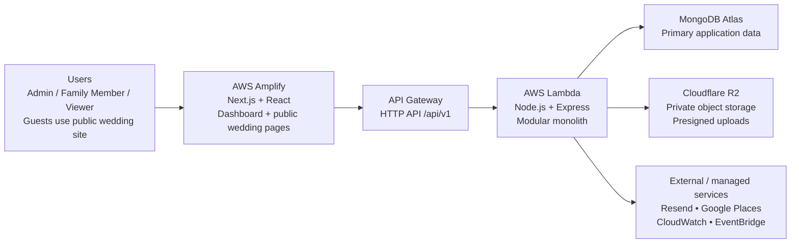
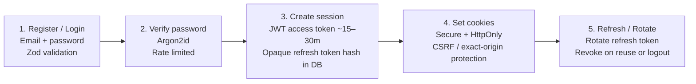
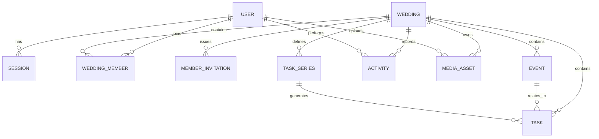
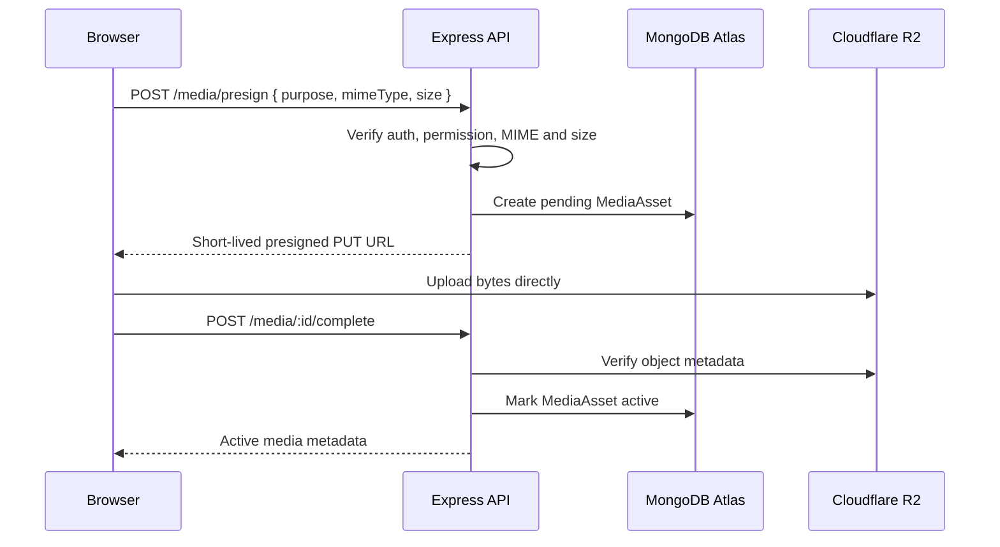
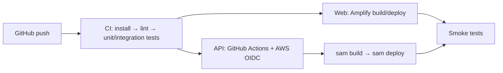

# Make My Marriage

## System Design & Architecture — Version 1.0

**Status:** Approved baseline for implementation  
**Date:** 03 October 2026  
**Product direction:** Indian wedding planning platform • Free-tier-first • Serverless • Modular monolith

> **Markdown note:** Architecture diagrams use Mermaid, so they render visually in GitHub and other Mermaid-compatible Markdown viewers.

| Frontend | Backend | Data |
|---|---|---|
| Next.js + React | Node.js + Express | MongoDB Atlas + Cloudflare R2 |


# 1. Document Purpose and Design Principles

This document converts the approved product and technology decisions for Make My Marriage into an implementation-ready system design. It defines boundaries, request flows, data ownership, authorization rules, deployment structure, operational controls, and the planned evolution from V1 to later versions.

> **Scope discipline:** The architecture is intentionally production-minded without being enterprise-heavy. We optimize first for correctness, maintainability, privacy, low operating cost, and a smooth path to scale.

| **Design principle**    | **Decision**                                                                                                |
|-------------------------|-------------------------------------------------------------------------------------------------------------|
| Start simple            | Modular monolith; no microservices, Redis, Kafka, ECS or Kubernetes in the initial product.                 |
| Server-side trust       | Every authorization rule is enforced in Express services/middleware; the UI is never the security boundary. |
| Free-tier-first         | Use managed/serverless services and quotas so development can remain near ₹0.                               |
| Wedding isolation       | Every wedding-scoped query verifies membership and weddingId ownership.                                     |
| Data longevity          | Soft delete important business records and retain an append-only activity history.                          |
| Async only where useful | Use EventBridge/Lambda jobs for cleanup/reminders; keep user-facing writes synchronous and understandable.  |
| Guest simplicity        | Guests use a richer public wedding page and RSVP links, not the internal SaaS dashboard.                    |

# 2. Final Technology Baseline

| **Layer**              | **Finalized technology**                                       | **Primary responsibility**                                                   |
|------------------------|----------------------------------------------------------------|------------------------------------------------------------------------------|
| Frontend               | Next.js App Router + React + JavaScript                        | Dashboard, forms, public wedding pages, responsive UX                        |
| UI                     | Tailwind CSS + shadcn/ui                                       | Reusable accessible UI primitives and SaaS dashboard styling                 |
| Forms                  | React Hook Form + Zod                                          | Client-side form state and validation                                        |
| Backend                | Node.js + Express.js                                           | REST API, business logic, authorization                                      |
| API                    | REST under /api/v1                                             | Stable versioned application contract                                        |
| Database               | MongoDB Atlas + Mongoose                                       | Application persistence and indexes                                          |
| Authentication         | Custom auth; Argon2id + JWT access + rotating refresh sessions | Identity, email verification, password reset, per-device sessions            |
| Email                  | Resend                                                         | Verification, password reset, member invitations, future transactional email |
| Object storage         | Cloudflare R2                                                  | Private profile/cover/document/gallery objects                               |
| Venue search           | Google Places + manual fallback                                | Venue autocomplete and location snapshot                                     |
| Frontend hosting       | AWS Amplify Hosting                                            | Next.js deployment and CDN hosting                                           |
| API compute            | AWS Lambda behind API Gateway HTTP API                         | Serverless Express runtime                                                   |
| Async jobs             | Amazon EventBridge + Lambda                                    | Cleanup, reminders and future scheduled jobs                                 |
| Observability          | Amazon CloudWatch                                              | Application logs, metrics and alarms                                         |
| Infrastructure as Code | AWS SAM                                                        | API Gateway, Lambda, EventBridge and CloudWatch resources                    |
| Containers             | Docker                                                         | Local development/testing parity                                             |
| CI/CD                  | GitHub + GitHub Actions + Amplify                              | Automated test/build/deploy pipeline                                         |

# 3. High-Level Architecture



*Figure 1. High-level deployment and request flow.*

The browser is the only application client in the initial release. The Next.js application is hosted on Amplify. Authenticated and public API calls enter through API Gateway and are handled by one Express application deployed as a Lambda function. The Lambda reads/writes MongoDB Atlas and integrates with R2, Resend and Google Places only through dedicated service adapters.

| **Boundary**     | **Rule**                                                                                                   |
|------------------|------------------------------------------------------------------------------------------------------------|
| Web -\> API      | The web app never connects directly to MongoDB. It only uses versioned REST endpoints.                     |
| API -\> database | Mongoose models are accessed from their owning backend module/service.                                     |
| API -\> R2       | Backend authorizes uploads and issues short-lived presigned URLs; browser transfers bytes directly to R2.  |
| API -\> Resend   | Only the backend sends transactional email.                                                                |
| Google Places    | Autocomplete may run in the browser with a restricted key; selected location data is stored as a snapshot. |
| Async workers    | Scheduled/cleanup Lambda functions reuse domain services but do not expose public HTTP endpoints.          |

# 4. Repository and Code Organization

Use two repositories so frontend and backend can deploy independently while keeping ownership simple.

```text
make-my-marriage-web/
├── app/
│   ├── (auth)/
│   ├── (dashboard)/
│   └── (public)/
├── components/
├── features/
├── lib/
│   ├── api/
│   └── auth/
├── schemas/
├── styles/
└── tests/

make-my-marriage-api/
├── src/
│   ├── modules/
│   │   ├── auth/
│   │   ├── users/
│   │   ├── weddings/
│   │   ├── members/
│   │   ├── events/
│   │   ├── tasks/
│   │   ├── checklist/
│   │   ├── activity/
│   │   └── media/
│   ├── middleware/
│   ├── services/      # email, storage, places adapters
│   ├── jobs/          # EventBridge-triggered handlers
│   ├── config/
│   ├── utils/
│   ├── app.js
│   └── lambda.js
├── template.yaml      # AWS SAM
└── tests/
```

> **Module rule:** Do not add a repository abstraction just for pattern compliance. Controllers handle HTTP concerns; services own business rules; Mongoose models handle persistence. Introduce a repository layer only if persistence logic becomes materially complex.

# 5. Frontend Architecture

## 5.1 Application areas

| **Area**            | **Users**                        | **Purpose**                                                                 |
|---------------------|----------------------------------|-----------------------------------------------------------------------------|
| Authentication      | Unverified / authenticated users | Register, login, verification, forgot/reset password, invitation acceptance |
| Internal dashboard  | Admin, Family Member, Viewer     | Planning, events, tasks, members, later finance/vendors/accommodation       |
| Public wedding site | Guests and public visitors       | Wedding information, selected events, venue details, RSVP, gallery later    |

## 5.2 Rendering strategy

- Use Server Components by default for public/read-heavy pages where possible.

- Use Client Components only for interactive dashboard elements, forms, filters, timers and optimistic UI.

- Centralize REST calls in one API client; UI components do not construct URLs or auth behavior themselves.

- React Hook Form + Zod validates before submission, but backend Zod validation remains authoritative.

- Permission-aware navigation may hide unavailable features, but backend authorization remains mandatory.

## 5.3 Dashboard information architecture

| **V1 dashboard block**     | **Source**                                                                       |
|----------------------------|----------------------------------------------------------------------------------|
| Wedding header + countdown | Wedding                                                                          |
| Planning progress          | Task aggregation                                                                 |
| Task summary               | Task aggregation                                                                 |
| My Tasks                   | Tasks filtered by current member                                                 |
| Upcoming events            | Events sorted by startAt                                                         |
| Attention Required         | Derived query: overdue/unassigned/high-priority/missing venue/approaching events |
| Recent activity            | Activity feed                                                                    |
| Quick actions              | Role-permitted actions                                                           |

# 6. Backend Modular Monolith

The backend is one deployable Express application, but code and data ownership are divided by business module. This gives simple deployment today and clean extraction points if one area ever needs independent scaling.

| **Module**           | **V1 responsibility**                                                    | **Future extension**                           |
|----------------------|--------------------------------------------------------------------------|------------------------------------------------|
| auth                 | Registration, login, email verification, refresh, logout, password reset | Social login later if required                 |
| users                | Profile and account state                                                | Account preferences                            |
| weddings             | Wedding root/settings, lifecycle, soft delete/recovery                   | Gallery Mode and public-site settings          |
| members              | Membership, roles, financeAccess, admin safety                           | More granular permissions only if truly needed |
| events               | Event schedule, venue snapshot, embedded activities                      | Guest invitations / public display settings    |
| tasks                | Task CRUD, assignees, priorities, recurrence occurrences                 | Notifications and richer automation            |
| checklist            | Versioned templates and idempotent task generation                       | Culture-specific template packs                |
| activity             | Append-only audit and dashboard feed                                     | Richer audit reporting                         |
| media                | R2 metadata and lifecycle                                                | Gallery albums, approvals, downloads           |
| guests / invitations | Not active in V1                                                         | V2 RSVP and event-level guest invitations      |
| budget / vendors     | Not active in V1                                                         | V3 finance and vendor management               |
| accommodation        | Not active in V1                                                         | V4 rooms and guest assignment                  |

# 7. Authentication, Sessions and Invitations



Member invitations use a separate 7-day token tied to the invited email. Password-reset and email-verification tokens are single-use, expiring, and stored hashed.

**Authorization is enforced server-side on every protected request:** wedding membership → role → finance permission / resource ownership.

*Figure 2. Authentication and session lifecycle.*

| **Control**        | **Design**                                                                                                              |
|--------------------|-------------------------------------------------------------------------------------------------------------------------|
| Password           | Minimum 8 characters with uppercase, lowercase and number; hash with Argon2id.                                          |
| Email verification | Required before dashboard access. Single-use expiring token stored only as a hash.                                      |
| Access token       | JWT, short lived (~15-30 minutes).                                                                                      |
| Refresh token      | High-entropy opaque token; hash stored in Session collection; rotate on refresh.                                        |
| Session model      | One session per device/browser so normal logout revokes only the current device.                                        |
| Password reset     | Single-use hashed token, 15-30 minute expiry, delivered by Resend.                                                      |
| Member invitation  | Email-bound secure token; 7-day expiry; user must login/register with matching email.                                   |
| Rate limiting      | Apply to login, registration, verification resend, reset and invitation-sensitive endpoints.                            |
| CSRF/CORS          | Exact allowed frontend origins; credentialed requests only; CSRF protection for mutating cookie-authenticated requests. |

> **Cookie deployment note:** For production, prefer app.example.com and api.example.com so auth cookies are same-site. During free-tier development using Amplify/API Gateway hostnames, use explicit Secure cookie/CORS/CSRF settings and test across Chrome, Safari and Firefox before launch.

# 8. Authorization and Permission Model

| **Capability**                  | **Admin** | **Family Member**       | **Viewer** | **Guest**                     |
|---------------------------------|-----------|-------------------------|------------|-------------------------------|
| View general wedding dashboard  | Yes       | Yes                     | Yes        | No                            |
| Manage events/tasks             | Yes       | Yes                     | No         | No                            |
| Manage members/roles            | Yes       | No                      | No         | No                            |
| View/manage finance             | Yes       | Only with financeAccess | No         | No                            |
| View public wedding information | Yes       | Yes                     | Yes        | Yes                           |
| RSVP                            | N/A       | N/A                     | N/A        | Via secure invitation context |

Authorization middleware is layered rather than encoded into every controller:

```text
authenticateSession
  -> requireWeddingMember(weddingId)
  -> requireRole(...)               # when an action is role-specific
  -> requireFinanceAccess()         # budget/expense/vendor financial endpoints
  -> service-level resource checks  # event/task belongs to the same wedding
```

- Last remaining Admin cannot be removed or demoted.

- Role changes take effect on the next API request; a stale browser tab never overrides current server permissions.

- Never accept weddingId ownership from the client without verifying membership.

# 9. Data Architecture and MongoDB Model



*Figure 3. V1 core collections and relationships. Aggregate roots are referenced; only small bounded substructures such as venue snapshots and event activities are embedded.*

## 9.1 Reference vs. embed rules

- Reference aggregate roots that grow independently: users, weddings, members, events, tasks, invitations, activities and sessions.

- Embed only bounded data that is normally read/written with its parent: venue snapshot and lightweight event activities.

- Do not create one giant Wedding document containing every event, task, guest and expense.

- Store timestamps in UTC. Keep the wedding timezone (initially Asia/Kolkata) for display and date calculations.

| **Collection**    | **Core fields**                                                                                                                  | **Index / lifecycle note**                         |
|-------------------|----------------------------------------------------------------------------------------------------------------------------------|----------------------------------------------------|
| users             | email, passwordHash, emailVerifiedAt, profile, avatarMediaId, status, createdAt, updatedAt                                       | Unique normalized email                            |
| sessions          | userId, refreshTokenHash, expiresAt, revokedAt, device metadata                                                                  | TTL on expiresAt; index userId                     |
| authTokens        | userId, type, tokenHash, expiresAt, usedAt                                                                                       | Unique tokenHash; TTL expiresAt                    |
| weddings          | name, slug, brideName, groomName, mainDate, timezone, tradition, location, estimatedBudget, coverMediaId, deletedAt              | Unique slug; soft delete / 7-day recovery          |
| weddingMembers    | weddingId, userId, role, financeAccess, status, joinedAt, createdBy                                                              | Unique (weddingId,userId)                          |
| memberInvitations | weddingId, email, role, tokenHash, status, expiresAt, invitedBy                                                                  | Unique tokenHash; prevent duplicate active invites |
| events            | weddingId, name, type, description, startAt, endAt, venue{}, activities\[\], status, createdBy, deletedAt                        | Index (weddingId,startAt), status                  |
| tasks             | weddingId, eventId?, title, status, priority, assigneeIds\[\], dueAt, seriesId?, occurrenceDate?, source{}, createdBy, deletedAt | Indexes for status/dueAt/assignees/event           |
| taskSeries        | weddingId, recurrence type, interval, start/end, template fields, generationVersion                                              | Unique generation key for idempotency              |
| activities        | weddingId, actorId, action, entityType, entityId?, displaySnapshot, createdAt                                                    | Index (weddingId,createdAt desc); append only      |
| mediaAssets       | weddingId?, ownerUserId?, purpose, objectKey, mimeType, size, status, createdBy, deletedAt                                       | Index objectKey; supports orphan cleanup           |

## 9.2 Soft delete, recovery and concurrency

- Important business entities use deletedAt rather than immediate hard deletion.

- Wedding deletion starts a 7-day recovery window. A scheduled purge may permanently remove wedding-scoped data and media only after the window expires.

- Activities remain as historical audit records while the wedding exists, even when the referenced task/event is deleted.

- Enable Mongoose optimistic concurrency / version checks on write-sensitive models. If a stale version is submitted, return HTTP 409 Conflict instead of silently overwriting newer data.

# 10. Checklist and Recurring Task Design

## 10.1 Checklist generation

- V1 checklist templates live as versioned JSON/config in backend source control rather than as editable database documents.

- Admin explicitly chooses Generate Checklist; wedding creation does not silently create a large task set.

- Generated tasks store source.type=checklist, templateId, templateVersion and itemKey.

- Generation uses an idempotency key so running the same template twice does not blindly duplicate tasks.

- If the user edits a generated task, later regeneration does not overwrite those edits.

## 10.2 Recurrence

- A recurrence definition is stored in TaskSeries; each actual occurrence is a normal Task document.

- Generate occurrences only through the relevant planning horizon, stopping at the wedding boundary unless explicitly allowed.

- Occurrence generation is idempotent using seriesId + occurrenceDate uniqueness.

- This keeps task completion/history simple: every due item has its own status and assignees.

# 11. REST API Design Standards

```text
/api/v1/auth/...
/api/v1/users/me
/api/v1/weddings/:weddingId
/api/v1/weddings/:weddingId/members
/api/v1/weddings/:weddingId/events
/api/v1/weddings/:weddingId/tasks
/api/v1/weddings/:weddingId/checklist/generate
/api/v1/weddings/:weddingId/activity
/api/v1/weddings/:weddingId/media/presign
```

| **Convention**    | **Decision**                                                                                              |
|-------------------|-----------------------------------------------------------------------------------------------------------|
| Response envelope | Success: { success, data, meta? }. Error: { success:false, error:{ code, message, details?, requestId } } |
| Validation        | Zod validates params, query and body at the route boundary.                                               |
| Pagination        | Page/limit for dashboard tables; cursor pagination for activity feeds or high-volume streams.             |
| Filtering         | Use explicit query params for status, priority, assignee, event, date and search text.                    |
| Sorting           | Whitelist sortable fields; never pass arbitrary client values directly to Mongo sort.                     |
| Idempotency       | Use deterministic keys for checklist/recurrence generation and important double-submit operations.        |
| HTTP conflicts    | Return 409 for stale-version writes, duplicate active invitation, or other state conflicts.               |
| Deletion          | DELETE usually soft-deletes important resources and returns a success acknowledgement.                    |

# 12. Event and Task Business Rules

| **Area**       | **Server-side rule**                                                                           |
|----------------|------------------------------------------------------------------------------------------------|
| Event time     | Reject endAt \<= startAt unless explicitly represented as next-day/cross-midnight.             |
| Event overlap  | Warn rather than block; Indian wedding events can legitimately overlap.                        |
| Venue          | Different events may have different cities/venues; manual address is always allowed.           |
| Activity time  | Warn if outside event time or overlapping; do not make this overly restrictive.                |
| Task assignee  | Unassigned task is allowed and surfaced in Attention Required.                                 |
| Task due date  | Warn on dates after wedding; block clearly invalid dates before creation as appropriate.       |
| Removed member | Unassign or explicitly reassign their outstanding tasks; never leave broken references.        |
| Event delete   | Tasks survive; eventId becomes null or references an archived event according to service rule. |

# 13. Cloudflare R2 Media Architecture

R2 is the finalized object store because the application is expected to become photo-heavy and R2 provides an S3-compatible API with a favorable bandwidth model. The bucket remains private.



- Use the AWS SDK v3 S3 client pointed at the Cloudflare R2 endpoint; keep provider-specific details inside StorageService.

- Object keys are server-generated, never trusted from a raw client filename.

- Replacing/removing a profile or cover image immediately detaches the DB reference and marks the old media for asynchronous cleanup.

- Future public gallery delivery uses signed URLs or an R2 custom-domain/CDN strategy; the raw bucket is not public.

# 14. Email and Venue Integrations

## 14.1 Resend

- EmailService owns provider calls so Resend can later be replaced by SES without changing domain logic.

- Templates: email verification, password reset, member invitation; RSVP/payment/reminder templates added in later versions.

- No secrets or token hashes are written to logs. Links contain only the raw one-time token required by the recipient.

## 14.2 Google Places

- Autocomplete uses a restricted browser key and session-based requests where practical.

- Persist a location snapshot: venueName, placeId, formattedAddress, latitude, longitude, city, state.

- Allow manual address entry if the venue is not present or precise enough in Google Places.

# 15. Asynchronous and Scheduled Work

Keep V1 synchronous by default. EventBridge-triggered Lambda jobs are used only when delaying work improves responsiveness or reliability.

| **Job**               | **When**                    | **Behavior**                                                                      |
|-----------------------|-----------------------------|-----------------------------------------------------------------------------------|
| R2 orphan cleanup     | Scheduled, e.g. daily       | Delete media marked orphan/deleted after a safety delay; update media status.     |
| Wedding purge         | After 7-day recovery window | Permanently remove wedding-scoped data/media only after final eligibility checks. |
| Reminder generation   | Later V3                    | Create/send task, event and payment reminders idempotently.                       |
| Notification delivery | Later V3+                   | Send in-app/email notifications without blocking the originating request.         |

> **No queue yet:** Do not introduce SQS/Redis/BullMQ in V1. If job volume or retry requirements outgrow EventBridge + Lambda, SQS is the first managed queue to consider.

# 16. Guest Experience and Public Wedding Site

Guests do not receive the internal SaaS dashboard. A richer public wedding page provides the information they need without exposing planning data or adding another heavy application surface.

| **Guest-visible**                                | **Never guest-visible**                    |
|--------------------------------------------------|--------------------------------------------|
| Bride/groom story and wedding countdown          | Internal task board                        |
| Selected event schedule                          | Budget, expenses or payments               |
| Venue + map + dress code/instructions            | Vendor contracts/internal vendor notes     |
| RSVP and attendee details                        | Member management or private activity feed |
| Accommodation/contact information when published | Internal planning alerts                   |
| Gallery and livestream link later                | Private family data                        |

- A public-site API uses an explicit allowlist/DTO; it never serializes internal Wedding documents directly.

- Guest-specific RSVP data is exposed only through a high-entropy invitation token tied to invited events.

- RSVP remains editable until the relevant event starts; Yes/No only; attendee count and meal choice are validated server-side.

# 17. Deployment and Environment Design

| **Concern** | **Staging**                                                    | **Production**                                          |
|-------------|----------------------------------------------------------------|---------------------------------------------------------|
| Frontend    | Amplify staging branch                                         | Amplify main/production branch                          |
| API         | Separate SAM stack                                             | Separate SAM stack                                      |
| MongoDB     | Separate database/credentials on free/shared cluster initially | Separate database/credentials; upgrade only when needed |
| R2          | Separate bucket or strict staging prefix                       | Production bucket/prefix with production credentials    |
| Secrets     | Separate AWS SSM parameters                                    | Separate AWS SSM parameters                             |
| Logs        | Short retention                                                | Longer but cost-controlled retention                    |



- Prefer GitHub OIDC to AWS rather than storing long-lived AWS access keys in GitHub secrets.

- SAM owns AWS infrastructure. R2, MongoDB Atlas, Resend and Google Cloud are external managed dependencies and are documented separately.

- No staging credential can access production data.

# 18. Security Architecture

| **Threat / control**  | **Design response**                                                                                   |
|-----------------------|-------------------------------------------------------------------------------------------------------|
| Broken access control | Verify authenticated user + wedding membership + role/permission for every protected resource.        |
| ID tampering          | Never trust route weddingId alone; verify the resource belongs to that wedding.                       |
| XSS                   | React escaping by default; sanitize any future rich HTML; avoid dangerouslySetInnerHTML.              |
| Injection             | Zod validation + Mongoose query construction; reject unapproved sort/filter operators.                |
| Credential theft      | Argon2id, short access lifetime, rotating refresh sessions, secure cookies, HTTPS only.               |
| CSRF                  | Same-site strategy where possible; CSRF token/origin validation for state-changing cookie requests.   |
| Abuse / brute force   | Rate limit auth/reset/invite/public RSVP endpoints.                                                   |
| Unsafe upload         | Allowlist MIME types, enforce size, generate object key server-side, verify uploaded object metadata. |
| Secret leakage        | SSM Parameter Store / deployment secrets; never commit secrets or log tokens.                         |
| Over-posting          | Use Zod DTOs; do not pass req.body directly into model updates.                                       |
| PII exposure          | Logs contain IDs/request metadata, not passwords, tokens, private guest data or finance details.      |

# 19. Logging, Audit and Observability

- Use structured JSON application logs with requestId, route, status, duration and safe identity/resource IDs.

- CloudWatch alarms: Lambda errors/throttles, API 5xx rate and abnormal latency. Add alarms gradually to avoid noisy operations.

- Business Activity collection is separate from operational logs. Activity is user-facing/audit history; CloudWatch logs are engineering diagnostics.

- Recommended initial log retention: short in staging and cost-controlled in production; extend only when a real support/compliance need appears.

- Every API error response includes requestId so a user-visible failure can be traced in CloudWatch.

# 20. Reliability and Error Handling

| **Scenario**             | **Expected behavior**                                                                            |
|--------------------------|--------------------------------------------------------------------------------------------------|
| Double submit            | Disable UI submit and use idempotency for important create/generation operations.                |
| Stale concurrent edit    | Return 409 with current version metadata; client asks user to refresh/reapply.                   |
| External service timeout | Use bounded timeout; return friendly retryable error; never hang the request indefinitely.       |
| Email failure            | Do not expose provider internals. Verification/invite can be resent; record safe delivery state. |
| R2 upload failure        | Pending MediaAsset expires/gets cleaned; user can retry with a new presigned URL.                |
| Mongo transient error    | Return 5xx with requestId; no partial write where a transactional invariant is required.         |
| Empty dashboard          | Return zero-safe aggregates and useful empty-state flags; never divide by zero.                  |
| Pagination after delete  | Clamp/reload to a valid page.                                                                    |

# 21. Cost-Control Architecture

The project is intentionally designed to run near ₹0 during development by keeping all high-cost always-on infrastructure out of the baseline.

| **Keep**                         | **Avoid initially**                        |
|----------------------------------|--------------------------------------------|
| Lambda + API Gateway             | EC2 always-on instances                    |
| Amplify                          | ECS/Fargate                                |
| MongoDB Atlas free/shared tier   | Dedicated MongoDB clusters before demand   |
| Cloudflare R2                    | Large S3/egress-heavy gallery architecture |
| EventBridge jobs                 | Redis/BullMQ just for scheduling           |
| CloudWatch with finite retention | Unlimited log retention                    |
| Usage quotas/budgets             | NAT Gateway, ALB, EKS, OpenSearch          |

- Configure AWS budget alerts at low thresholds (for example ₹100 / ₹250 / ₹500 during development).

- Set Google Places quota limits and Cloudflare/MongoDB usage alerts.

- Apply upload size limits and lifecycle cleanup so test media cannot grow without bounds.

- Upgrade only when a measured limit is reached; do not pre-provision production-scale infrastructure.

# 22. Non-Functional Requirements

| **Area**        | **Initial target**                                                                                                    |
|-----------------|-----------------------------------------------------------------------------------------------------------------------|
| Availability    | Single-region managed/serverless deployment; no multi-region requirement.                                             |
| Performance     | Fast dashboard interactions; typical API responses should be sub-second excluding cold starts/external calls.         |
| Scalability     | Stateless Lambda API; Mongo indexes designed by access pattern; direct object uploads avoid API bandwidth bottleneck. |
| Security        | HTTPS, secure sessions, least privilege, private object storage, backend authorization.                               |
| Maintainability | Clear module ownership, shared validation, service adapters, two deployable repos.                                    |
| Data integrity  | Optimistic concurrency, idempotent generators, soft delete and audit feed.                                            |
| Responsiveness  | Desktop/tablet/mobile supported equally; no separate mobile app initially.                                            |
| Accessibility   | Use shadcn/Radix semantics and sensible keyboard/labels even though formal certification is not a V1 requirement.     |

# 23. Scaling and Evolution Path

| **Trigger**                                    | **Evolution**                                                                                               |
|------------------------------------------------|-------------------------------------------------------------------------------------------------------------|
| API Lambda latency/cold-start becomes material | Tune bundle/concurrency; then consider container/Lambda Web Adapter or ECS only if measurements justify it. |
| MongoDB free/shared limits reached             | Move to paid Atlas tier and add indexes/read tuning before changing database technology.                    |
| Background retries/volume increase             | Introduce SQS between API/jobs and worker Lambdas.                                                          |
| Media processing becomes heavy                 | Extract media-processing worker Lambda(s); keep R2 and MediaAsset contract.                                 |
| Notification volume grows                      | Extract notification worker/module; potentially separate service only when operationally justified.         |
| True realtime requirement appears              | Add SSE/WebSockets for targeted views rather than making the whole app realtime.                            |
| Multiple weddings per user needed              | Relax the current one-active-wedding product rule; data model already supports many memberships.            |

> **Microservices decision:** No business module should be extracted merely because the codebase grows. Extract only when it needs independent scaling, deployment cadence, fault isolation or ownership.

# 24. Version Roadmap Mapped to Architecture

| **Version** | **Modules activated / extended**                                                          |
|-------------|-------------------------------------------------------------------------------------------|
| V1          | auth, users, weddings, members, events, tasks, checklist, activity, media                 |
| V2          | guests, guest groups/tags, event invitations, RSVP token flows                            |
| V3          | budget, expenses, payments, vendors, notification jobs; finance middleware becomes active |
| V4          | accommodation/hotels/rooms/assignments linked to guests and budget                        |
| V5          | public-site configuration, gallery/media approvals, download delivery, Gallery Mode       |
| V6          | culture/tradition template packs, smarter date suggestions and planning heuristics        |

# 25. Architecture Decision Record Summary

| **ID**  | **Decision**                   | **Reason**                                                                                               |
|---------|--------------------------------|----------------------------------------------------------------------------------------------------------|
| ADR-001 | Modular monolith               | Lowest operational complexity with clear future extraction boundaries.                                   |
| ADR-002 | Next.js + separate Express API | Keeps frontend concerns separate from domain/business API.                                               |
| ADR-003 | MongoDB Atlas + references     | Flexible wedding domain while avoiding giant embedded documents.                                         |
| ADR-004 | Custom auth                    | Meets learning/control goals and supports invitation-specific business rules.                            |
| ADR-005 | Resend first                   | Simpler transactional email for MVP; provider hidden behind EmailService.                                |
| ADR-006 | Cloudflare R2                  | S3-compatible object storage well suited to future photo-heavy usage.                                    |
| ADR-007 | AWS serverless hosting         | Lambda/API Gateway/Amplify fit free-tier-first and low-traffic launch.                                   |
| ADR-008 | No guest dashboard             | Public wedding site + secure RSVP context provides guest value without duplicate application complexity. |
| ADR-009 | Soft delete + activity feed    | Supports recovery, accountability and safer collaborative editing.                                       |
| ADR-010 | Optimistic concurrency         | Avoids silent overwrites without introducing heavy locking.                                              |

# 26. Recommended V1 Implementation Order

1.  Bootstrap web/API repositories, Docker, lint/test, environment validation and SAM/Amplify staging deployment.

2.  Implement User, Session, AuthToken and authentication flows end-to-end including Resend.

3.  Implement Wedding + WeddingMember + invitation acceptance and authorization middleware.

4.  Implement Event model/API/UI including Google Places snapshot and manual location fallback.

5.  Implement Task + TaskSeries + assignment/filtering and concurrency checks.

6.  Implement checklist templates and idempotent generation.

7.  Implement Activity feed and dashboard aggregations / Attention Required queries.

8.  Implement MediaService + R2 presigned upload for avatar and wedding cover.

9.  Add production-hardening: rate limits, CSRF/CORS, alarms, budgets, log retention, backup/restore checks and E2E smoke flows.

# 27. Architecture Definition of Done for V1

- A user can register, verify email, login, refresh session, reset password and logout from one device.

- An Admin can create a wedding, invite collaborators and safely manage Admin/Family Member/Viewer roles.

- All wedding-scoped API endpoints reject cross-wedding ID manipulation.

- Events and tasks support the agreed validations, filters, recurrence and optimistic concurrency behavior.

- Checklist generation is explicit, idempotent and never overwrites modified tasks.

- Dashboard aggregates are zero-safe and role-aware.

- R2 uploads are private, authorized, size/type validated and asynchronously cleaned when replaced/deleted.

- CloudWatch request tracing and audit activity are both available.

- Staging and production are isolated; CI/CD can deploy both without manual source changes.

- The deployed V1 remains inside the intended free/near-zero operating-cost envelope at development usage.

# 28. Final Architecture Statement

Make My Marriage will begin as a serverless, free-tier-first modular monolith: a Next.js SaaS frontend on AWS Amplify, a versioned Node.js/Express REST API on API Gateway + Lambda, MongoDB Atlas for application data, Cloudflare R2 for private media, Resend for transactional email, and Google Places for venue assistance. The design deliberately avoids premature infrastructure while preserving clean module boundaries, secure authorization, recoverable data, auditable collaboration, and clear growth paths for guests, finance, vendors, accommodation and gallery features.

**Baseline status:** *Implementation baseline; future changes should be captured as explicit architecture decisions.*
